# Stick to the Script — dev log

Entry for the 2026 Epic AI MegaJam (theme: Director's Cut). This log records, as it happens, what the human developer directed, what the AI agent did, what tools were used and what went wrong.

**How this game is being made.** One developer directs; an AI coding agent (Claude Code desktop, model Claude Fable 5.2) does the research, writes the code and drives the Unreal editor. The agent writes each entry at the time of the work. Times are local (UTC+1). Times marked "~" are approximate.

**Declarations.** Nothing in the game was made before the jam started on Nov 12. No prompts, scripts or assets were prepared in advance.

---

## Day 1 — Thu Nov 12, 2026

### ~09:55–10:15 · Rules and tooling

- **Developer asked:** find every jam rule that affects setup, pick a model, and install helper plugins for the agent.
- **Agent did:** read the official jam page and the announcement thread, and found the theme from Epic's kickoff post. Wrote the hard constraints (deadline, packaged build, zip name, 1 GB limit, submission checklist) into `CLAUDE.md` so every later agent session starts from them.
- **Agent tooling installed:** two behaviour plugins that push the agent toward small, simple changes (ponytail, Karpathy guidelines) and Anthropic's claude-code-setup. These shape how the agent works; none of their content ships in the game.
- **Went wrong:** the Official Rules PDF is not machine-readable, so the agent could not check it. The developer needs to read eligibility and build-configuration wording by hand. One plugin install failed because the terminal copy of Claude Code was too old to read the plugin catalogue; the agent used the app's bundled copy instead.

### ~10:15–11:15 · Concept

- **Agent pitched** three concepts for the theme: a camera whose frame decides what exists, a fight scene built from replays of your own takes, and a platformer about restoring cut features.
- **Developer countered** with their own idea: fighting stick figures plus a body cam, where a mistake gets you a "Cut!" and a clean take becomes a short edited film of the moves you really used.
- **Agent shaped it** into one loop and gave it a working title, Stick to the Script:
  - You play the fight in first person through a body cam. That is the raw footage.
  - A clean take replays from outside as an edited stick-figure action scene. That is the Director's Cut.
  - The script gives cues and constraints, not exact buttons, so the final cut is different for every player.
  - Every failed take is kept for a blooper reel.
- **Proof before building:** the developer asked to see it first, so the agent built a playable 2D mock inside the chat (HTML canvas, about 150 lines): four beats, body-cam view, "Cut!" screen, and an auto-edited replay with a close-up on each hit. The developer played it and approved the direction.
- **Decision:** stick figures stay, drawn on Unreal's standard human skeleton, so real motion-captured animation can drive them.

### 11:20–11:26 · Project created

- **Developer said:** "Yes, build it."
- **Agent did:**
  - Wrote a minimal C++ project by hand (project file, two build targets, one empty game module, three config files) instead of copying a starter template, so the game starts with no template gameplay in it.
  - Found that the engine already ships fight animations for its mannequin (three attacks, a charged attack, eight hit reactions, six knockdowns) and copied those, with the mannequin itself, into the project. This removed the biggest risk on the list, which was finding licensed fight animations.
  - Enabled Unreal's MCP server and toolset plugins for the editor only, so they cannot end up in the packaged game.
  - Initialised git with LFS for binary assets.
- **Result:** first compile succeeded in 140 seconds on Visual Studio 2026.
- **Still open:** the shipped animations cover attacks, hits and knockdowns but not blocks or ducks. Those need another source or a procedural pose.

### 11:27–11:35 · First stick figures in the engine

- **Agent did:** wrote `AStickFighter`, about 100 lines of C++. It keeps the engine mannequin hidden and animating, and each frame stretches 15 cylinders between pairs of its bones, plus a sphere for the head. Any animation made for the standard skeleton now plays as a stick figure.
- **Result:** two fighters facing each other, both playing the engine's motion-captured punch. The capture above was taken by the agent through the editor's MCP server.
- **Went wrong, and the fixes:**
  - First capture showed one fat cylinder and a ball at the world origin. The limbs were only posed in `Tick`, and the editor does not tick actors while its window is in the background, which it always is when an agent drives it. Fix: pose the figure at construction as well, and turn off the editor's background throttling for this project.
  - The agent's own session could not reconnect to the editor's MCP server after the editor started (only the developer can re-dial it). Workaround: the agent talks to the server directly over local HTTP with a 40-line script.
  - Adding a new C++ class needs an editor restart. Three restarts so far, 15–25 seconds of compile each.
- **Next:** the body-cam player view and the beat system (cue, valid responses, "Cut!").

### 11:36–11:46 · First commit, a plan for a team, and rules that protect the base

- **Developer asked:** commit, then plan the whole jam in Obsidian with phases, sprints and tasks that can be given to different teammates and combined later, and write a rules file so nobody who joins breaks the project.
- **Agent did:**
  - Committed the project base after checking that no personal or employer information was in any file.
  - Wrote the plan into `Plan/`: 47 task notes across 5 sprints and 6 streams, generated from one table by a short script so every note has the same shape (owner, status, dependencies, the paths it owns, and a "done when" list). A board file shows them by sprint, owner, stream and status.
  - Designed the split so parallel work cannot collide: each stream owns its own folders, binary assets have one owner, and streams talk only through a shared set of types and events described in `Plan/Contracts.md`.
  - Rewrote `CLAUDE.md` as team rules for people and agents: how to take a task, the pre-merge check, who owns the shared files, and a privacy rule.
  - Added `Tools/check.ps1`, a one-command compile check, and made this dev log merge by union so entries appended by different people never conflict.
- **Went wrong:** two task titles contained a colon, which Windows silently turned into hidden data streams instead of files. The agent noticed because two files had no extension, renamed the titles and regenerated.
- **Not verified:** the board file has not been opened in Obsidian by the agent, and the check script's failure path was not exercised.

### 13:13 · Repository shared privately

- **Developer asked:** create a private GitHub repository and push the project.
- **Agent did:**
  - Before anything left the machine, scanned every commit for personal information: file contents, file paths, commit messages and the author identity on each commit. Nothing found.
  - Created the private repository and pushed `main`: three commits plus 68 binary assets (106 MB) through Git LFS.
  - Checked the result instead of trusting the push output: the repository is private, the remote `main` is the same commit as the local one, and the only collaborator is the developer.
- **Went wrong:**
  - GitHub reported 15 MB for one mannequin asset, which looked as if the asset had gone into git history instead of LFS. It had not: git holds a 133-byte pointer, and GitHub reports the size of the file the pointer stands for. The only file over 1 MB in git history is the screenshot in this log.
  - While the agent was pushing, the developer tried to close the editor and it asked to save. The only unsaved thing was the scratch level used for the screenshot above, which was never meant to be kept.
- **Not done yet:** `main` is not protected on the remote, no teammate has been invited, and tasks have no owners.

### 13:19 · Protecting main without the host's help

- **Developer said:** protect `main` against force-push and deletion.
- **Went wrong first:** GitHub refused, twice. Branch protection and its newer replacement (rulesets) are both paid features for a private repository.
- **Agent did instead:**
  - Wrote a 20-line push hook, kept in the repository at `Tools/hooks/pre-push`. Before any push it refuses two things: deleting `main`, and replacing `main` with history that does not contain what is already there.
  - Made the compile check switch the hook on. Every teammate already has to run `Tools/check.ps1` when they set up and before every merge, so there is no extra step to forget.
  - Caught a trap before it cost anything: pointing git at a hooks folder inside the repository silently turns off the hook Git LFS installs, which is the one that uploads binary assets. Pushes would have kept succeeding while the assets stayed behind. The new hook runs the LFS upload itself.
  - Added a five-case test (`Tools/test-push-guard.sh`).
- **Result:** the test passes, and git refused a real attempt to delete `main` and a real attempt to force an older commit over it. Both were dry runs, so nothing could reach the remote if the guard had failed.
- **Limit:** this stops accidents. Anyone who pushes with `--no-verify` skips it, so the team rules forbid that. Only a paid plan would enforce it on the host.

### 13:27–13:33 · The shared contract every stream builds against (S1-CORE-01)

- **Directed:** the lead's agent session handed the first task of sprint 1 to a second agent session: build the shared types and events from `Plan/Contracts.md` on their own branch, declarations only, and stop before merging.
- **Agent did:**
  - Wrote `Core/TakeTypes.h` with the six types the contract names: `EMove`, `EBeatKind`, `FBeat`, `FSceneScript`, `ECutReason` and `FTake`.
  - Added three structs and one enum the contract implied but did not name: `FRecordedEvent` with its kind, `FTakeFrame` and `FFighterPose`. "The event list" needed a shape, and Unreal cannot expose an array of arrays, so each level of "per frame, per fighter, per joint" is its own struct.
  - Wrote `UTakeEvents`, a world subsystem with the seven events. It listens to its own events and writes one log line for each, so the Output Log shows the order of a take.
  - Added one automation test that fires all seven events and counts the log lines.
  - Updated `Plan/Contracts.md` from "planned" to the real field names and parameter types, plus three rules the code cannot enforce (time base, partner numbering, fighter order).
- **Result:** `Tools/check.ps1` prints `PASS`. The test passed in a headless editor run, and the log shows seven lines, one per event.
- **Went wrong:** the first compile failed. The agent included the header as `Core/TakeEvents.h`, but the compiler's include root is `Source/`, not the module folder. The working form is `StickToTheScript/Core/TakeEvents.h`, and it is now in the contract so the other streams do not hit the same error.
- **Agent's choices, for the lead to review:** the contract did not say how a hit names its fighters. Live events pass actors. Recorded events store an index into the frame's fighter list, which is always the player first, then partners A, B and C.
- **Not done:** not merged into `main`, and the pre-merge play-through has not been done. `OnTakeFinished` carries an `FTake`, but nothing decides yet whether the director or the recorder fills its frames.

### 13:36 · Shared contract merged into main

- **Developer said:** "Merge and push."
- **Agent did:** fetched the remote (no new commits on `main`), moved `main` forward to the task's commit without a merge commit, pushed it through the push guard, and marked S1-CORE-01 done.
- **Result:** the remote `main` is the same commit as the local one. The other streams can now build against the shared types and events.
- **Went wrong:** the agent re-ran the compile check just before merging and it failed, because the editor had been opened in the meantime and Unreal refuses to build while Live Coding is active. The agent did not close an editor it had not opened. It checked instead that nothing had changed since the last `PASS`: the working tree was identical to the commit, and the built module was newer than every source file.
- **Not verified:** "play Stage 1 once" could not be done, because no level exists yet. Binding the events from a Blueprint is still untested.

### 13:42 · Solo run

- **Developer decided:** to run the jam solo, as one developer directing AI agents.
- **Agent did:** assigned all 42 open tasks to the developer's handle, updated the team note, and changed one rule. An agent may now do tasks one after another in the same session, each on its own branch and merged before the next starts, instead of one task per session.
- **Consequence:** the plan was sized for three to five people, so the cut order written into it now matters. The first decision point is the checkpoint at the end of sprint 1.

### 13:43–13:52 · The take loop works: beats, "Cut!", retake (S1-CORE-02, S1-CORE-03)

- **Developer said:** "lets continue", and while the agent worked: keep in mind different scenes with exciting fights, one against many and not only one against one, more action and prettier.
- **Agent did:**
  - `ATakeDirector`: plays a scene script beat by beat. Each beat opens a time window, the player's move is judged by one pure function, a failure calls cut with a reason (got hit, missed cue, too slow) and restarts as the next take, and the last beat finishes the take. An attack thrown between cues also cuts. The built-in scene has four beats, and its last one accepts a punch or a kick, so two clean takes can differ.
  - Player input for keyboard and gamepad, built in code, so there is no binary input asset to keep in step with the move list. A console command plays a move without a device.
  - A game mode that wires the two together, set as the project default.
  - Two automation tests (the judging rule, and a whole run of cuts, retakes and a clean finish), and made the pre-merge check run the tests after compiling. `PASS` now means the project compiles and its tests pass.
- **How it was verified:** the agent played it. It started Play-In-Editor through the editor's MCP server, watched the log for each beat opening, and pressed the real keys through the editor's UI automation. Take 1: a punch on a defend beat, cut, "got hit". Take 2: a duck, then a kick where the script wanted a punch, cut, "missed cue". Take 3: block, punch, duck, kick, and the take finished clean.
- **Went wrong:**
  - Two compile errors, both the agent's: treating the engine's world proxy as a pointer, and a nested initializer list the engine's pair type does not accept. Each cost one 10-second compile.
  - The first play-through timed out on every beat. The key presses were going to the editor, not the game: the game viewport only receives keys after it has been clicked. Proved it by throwing a punch during the lead-in after a click and seeing the "missed cue" cut appear.
  - To check that the new test step really fails when it should, the agent broke one expectation on purpose. The check printed `FAIL` and named the test. The line was restored.
- **On the developer's note:** the design already allows one against many. Every beat names which stunt partner acts, and a scene can have three. Scenes are data that the director plays, so more scenes and longer fights are new scripts and stages, not new code.
- **Not verified:** the gamepad and the arrow keys (same code path as the tested keys, but not pressed). Nothing is visible yet: the loop runs in the log, with no fighters reacting and no interface.

### 13:53–14:15 · The fight is visible: strikes land, guards go up, a knockout is a ragdoll (S1-FIGHT-01, 02, 03)

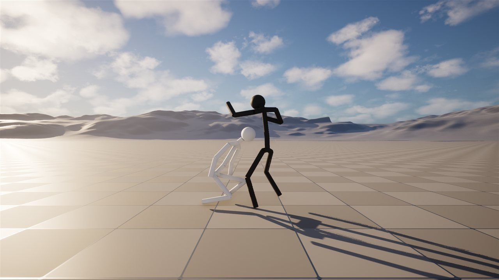

- **Agent did:**
  - The fighter now plays three punches and a heavy strike, flinches when hit, falls when knocked out, and can block and duck. It reports the 16 joint positions it is drawn from, which is all a recording of a take will need.
  - A stunt partner that follows the script. On a defend beat it throws its strike with the wind-up stretched so that it arrives as the beat window closes; on an attack beat it takes the player's strike.
  - The game mode spawns the player's fighter and one partner per opponent the script uses, on tagged marks, or around the origin if the level has none. Any level is now playable.
  - Two new script fields: what the partner throws, and whether a strike knocks the partner out. A console switch (`sts.Autoplay 1`) plays a scene with no input.
- **How it was verified:** three rounds of play, look, fix. Each round the agent played a take in the editor with real key presses, captured a frame after each move, and looked at the frames. The three above are from the last round. Autoplay was checked by running the game as its own process outside the editor, with no input: the take finished clean.
- **Went wrong, and what replaced it:**
  - *Hit reactions.* The engine's hit reactions are additive animations and show nothing when played alone. The flinch is computed on the stick's joints instead: the higher the joint, the further it is knocked back.
  - *Knockdown.* The engine's death animations end with the character still on its feet, because they expect a ragdoll to take over. The "knocked out" partner stood bent over. The fall is now a ragdoll of the hidden mannequin, which the stick figure follows.
  - *The first ragdoll.* The partner vanished from the frame. The launch speed, 6 m/s on every bone, threw him about 14 metres. Halved it.
  - *Lunges.* The attacks carry root motion, so fighters lunged through each other and snapped back. Root motion is now ignored, the reach of each strike was measured (92 to 106 cm), and the partner stands 100 cm away.
  - *Motion blur* smeared the thin limbs into ghosts. Turned off for the project.
  - *Duck.* The first attempt reused the engine's landing animation, which turned out to be a barely visible knee bend. Replaced with a real crouch: hips dropped 45 cm, a forward lean, knees placed by two-bone IK. Block uses the same solver to raise the forearms.
  - *A contract mistake caught early.* The plan said code finds marks and cameras by actor name. Actor labels do not exist in a packaged game, so that would have worked in the editor and failed in the build. Changed to actor tags before any level was made.
  - *The agent's own slips.* A half-written function was saved into the game mode file and caught before compiling. A stray command hung for two minutes. The editor ignored a polite request to close; the agent checked that no play session, dialog or unsaved change was open before ending the process it had started.
- **Not verified:** the gamepad; a second and third opponent (the spawning handles them, but the built-in scene uses one); the move demo switch; and all of it on a real stage instead of the engine's default level.

### 14:16–14:30 · Cues on screen, a body cam, and the director changes his mind (S1-FEEL-01, S1-CAM-01)

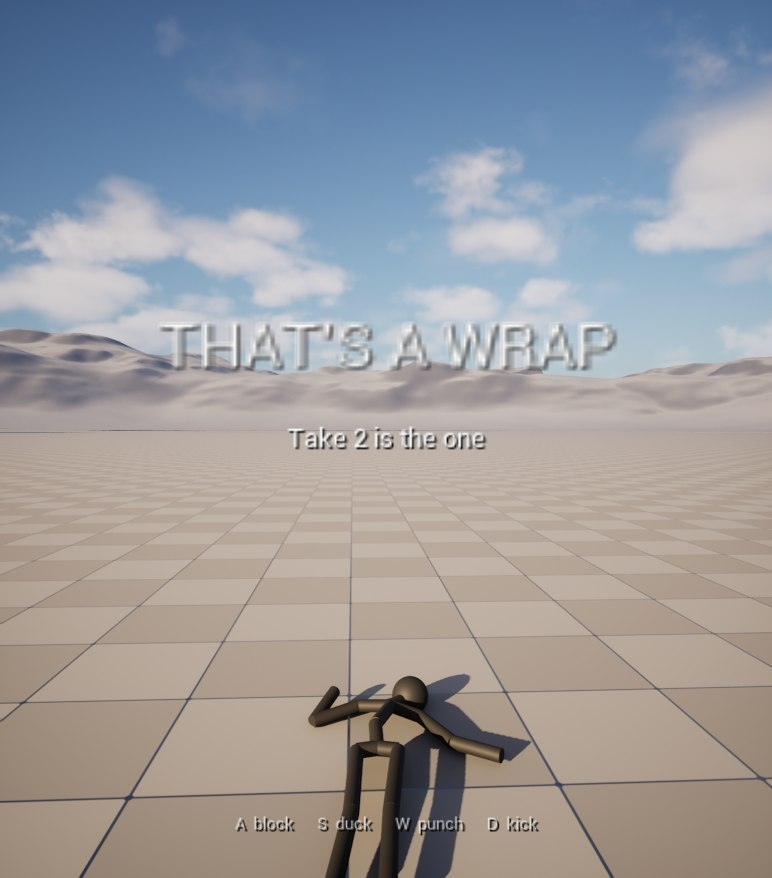

- **Agent did:**
  - The on-screen cues: a recording light with the take number, the beat's cue with a bar that runs out, a "Cut!" slate that says why, and a wrap card. They are drawn by a HUD class that only listens to the take events, so the interface cannot break the take loop.
  - The body cam: a first-person camera that follows the player's fighter, lags a little, shakes, and jolts when a strike lands.
- **Went wrong with the body cam, found by looking at frames:**
  - Mounted on the chest, as planned, it could not see the player's own guard: the forearms were above the frame. Moved to eye level.
  - It turned with the torso, and a punch twists the torso so far that the opponent left the picture. Cut the twist to a fraction.
  - The head lunges forward in a punch, which slid the opponent to the edge of the frame again. The camera now keeps looking at the spot where the opponent stands.
- **Then the developer changed direction.** While the agent was on the third fix, the developer wrote: "i am having second thoughts, maybe we should not use body cam and view the whole character so we can see more details of the fight and add more physics and animation to the body and parts when get hit, blood, broken bones and sound effects and visual effects".
- **Agent's answer:** agreed, and said why. In the frames it had been capturing, the fight read clearly from outside and was chaotic in first person, with the best moments (the guard, the ragdoll) happening out of frame. Recommended playing from outside, keeping the body cam as a second angle and for point-of-view inserts in the final cut, and spending the time saved on impact.
- **Result:** the outside view is the default. The body cam is one key press away (V) and costs nothing to keep. A new task, the impact pass, replaces the optional body-cam lens work: blood, limbs that break, a reaction where the body is struck, camera shake, a freeze-frame on heavy hits, and sound.
- **Not verified:** the take card before the first beat was never captured in a frame. The interface font is a scaled bitmap and looks soft.

### 14:31–14:48 · The impact pass: blood, a broken arm, a frozen frame, and sound made in code (S1-FEEL-03)

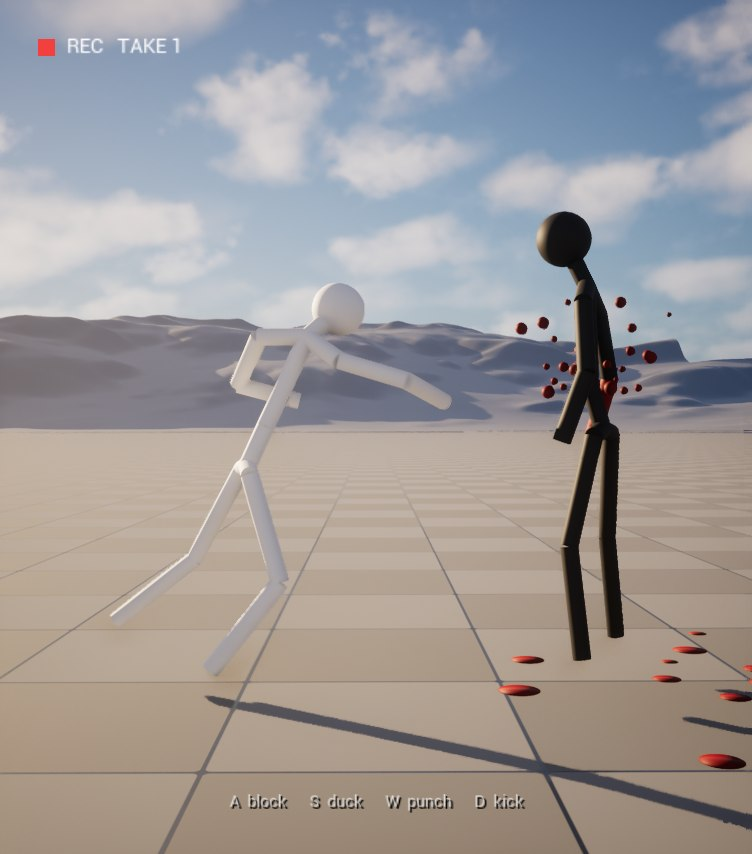

- **Developer said:** "Yes, impact pass". And, while the agent worked: let the player customise their character simply, and show that exact character in the final video, so it feels like they really did the scene.
- **Agent did:**
  - **Hits land somewhere.** A strike now reports the point where it landed. Each joint of the victim is pushed by how close it is to that point, so a punch to the head snaps the head back and a body shot folds the body.
  - **A heavy hit breaks an arm.** The forearm becomes a pendulum hung from the elbow: gravity pulls the hand down and the fighter's own movement swings it. It is drawn in two dark red pieces that meet at an angle.
  - **Blood.** A burst from the point of impact, thrown along the strike. Drops that reach the floor flatten into marks, which stay through later takes, so the set gets messier the more takes you need.
  - **Sparks** off a raised guard, from a new event for a blocked strike.
  - **Time.** Every hit freezes the frame for a few hundredths of a second, longer for a heavy one. The knockout plays at a fifth of normal speed.
  - **A fight camera** that shakes and pushes in on impact, shared with the body cam's shake.
  - **Sound, with no audio files.** Thuds, cracks, a whoosh, a clapper for each take and a sting for "Cut!" are synthesised when the game starts, from sine sweeps and filtered noise. Nothing to license, nothing to store.
  - The built-in scene grew from four beats to six, with the heavy kick in the middle and a second block.
- **How it was verified:** two rounds of playing the six-beat scene with real key presses and looking at frames. The log shows the blocked strikes and the hits in order.
- **Went wrong:**
  - The first broken arm did not look broken. A forearm hanging straight down looks like a relaxed arm. Drawing it bloodied, in two pieces at an angle, fixed that.
  - The knocked-out partner still flew out of the picture in the editor's narrow window. Lowered the launch speed again.
  - The sound code compiled but did not link: the engine's synthesiser base class lives in a module the project did not reference. Added it to the build file.
  - **The agent cannot hear.** It confirmed that the synthesiser produces audio (it logs its first audible buffer, peak 0.64) and that no audio error is logged. Whether a punch sounds like a punch is for the developer's ears.
- **Decided for later:** the character look is now a task of its own: a colour and one accessory, stored with the recorded take so the final cut draws the same character.
- **Not verified:** the sounds by ear; the broken arm from the other side; and what a broken arm should do to the partner's later punches, which still swing as if nothing happened.

### 14:49–15:02 · The Director's Cut: a clean take replays as an edited film (S1-CAM-02, S1-CAM-03)

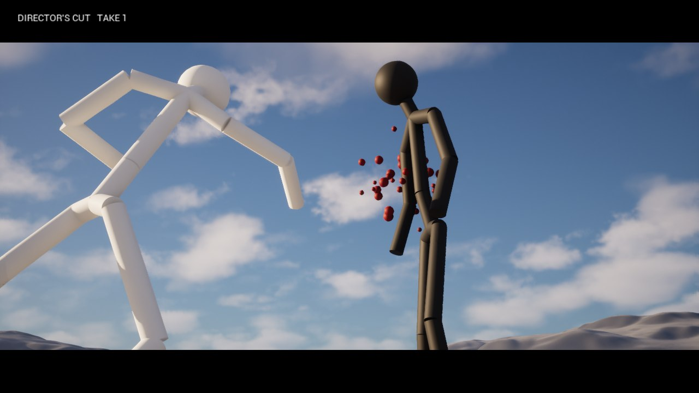

- **Developer said:** "Yes, the replay". And, thinking out loud while the agent worked: advertise the game as a playable movie, where the player is an actor paid to do the scene, follows the scenario, and then sees the result of the real scene; and keep in mind different scenarios, with actions that are not only fighting.
- **Agent did:**
  - **A recorder** that keeps every fighter's 16 joints on every tick, plus every event of the take. A 10.8-second take of two fighters is 933 frames and 0.75 MB, so a full minute would be about 4.2 MB.
  - **The film.** After a clean take the fighters themselves become puppets posed from the recording, so the film shows the same characters, broken arm included. The picture is letterboxed and titled.
  - **An edit, made automatically from the take's events:** a wide shot by default, a side close-up from just before each strike to just after, and a low camera looking up for heavy hits and the knockout. Strikes that come close together share one run of close-ups.
  - **No replay code for the effects.** The film fires the recorded hits and blocks again as the same events the live game uses. Blood, camera shake, the frozen frame, slow motion on the knockout and the sounds all come back by themselves, because they only ever listened to events.
  - When the film ends, the scene is shot again.
- **Agent's answer on the pitch:** agreed, and tightened it. A playable movie: you are a stunt performer hired for a scene; stick to the script, get the take, watch the film you made. Pay is the score: each scene has a fee and every "Cut!" takes a bite out of it. Other stunts fit the system as it is, because a beat is only a cue, a window and the moves that count. It is all written into the plan.
- **How it was verified:** the agent played a clean take and let the film run, capturing a frame every 0.65 seconds. The event log shows the film firing the same five strikes in the same order as the take. A fourth automation test records ten frames and reads them back. A second run failed the first take on purpose and finished the second with a punch instead of a kick: the film showed only the clean take, ending on the punch.
- **Went wrong:**
  - The recorder would not compile under its first name. The engine already has a header called `TakeRecorder.h` in a virtual-production plugin, and Unreal refuses two headers with one name. Renamed to `FightRecorder`.
  - The first film had two bad cameras. The close-up was so tight it showed one forearm, and the low camera sat behind the player and filmed their back. Both were moved.
  - The agent had been judging framing in the editor's narrow viewport, which crops the sides. It now plays in a separate 16:9 window, which is what a player sees.
- **Not verified:** more than one opponent in the film; the film's sound by ear; and the low camera still cuts heads off on some hits.

### 15:03–15:40 · A real stage, key prompts, and the first packaged build (S1-STAGE-01, S1-SHIP-02)

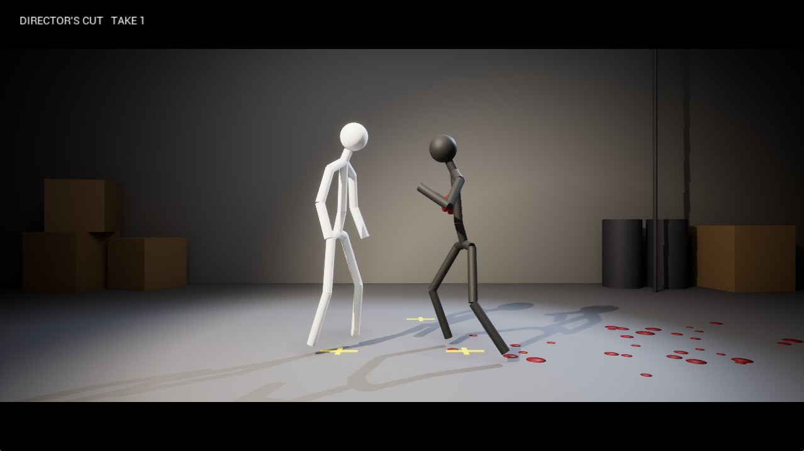

- **Developer said:** "Yes, stage and build". Then, while the agent worked: replace the timer bar with the kind of prompt other games use, a circle with the key to press and a ring that closes around it, on the fighter; and later, remove the key legend at the bottom now that the prompts exist.
- **Agent did:**
  - **Stage 1 as a script.** `Tools/build_stage01.py` builds the level: a closed soundstage 14 by 13 metres, tape marks where the performers stand, three tagged film cameras, a warm key light, a cool rim light, a soft fill, haze, crates and barrels. The level is a real asset the developer can open, and the script is its source.
  - **Fixed exposure.** Without it the engine brightened the closed room to an even grey. With it the set is dark with a pool of light, which is what a stage looks like.
  - **Key prompts.** One circle per move that counts, with its key inside and a ring that closes as time runs out. It sits above the player's fighter when defending and above the opponent when striking. The script line stays as a subtitle; the bar and the legend are gone.
  - **Autoplay on a key (P),** so a demo, a recording or a test can run without anyone hitting cues.
  - **Packaging in one command.** `Tools/package.ps1` makes a Windows Development build and fails if an editor-only plugin is inside.
- **Result:** the packaged game is 629 MB before zipping. Run on its own, outside the editor, it played a clean take, showed the film and started the next take; its log shows the sound synthesiser producing audio and no errors.
- **Went wrong, in the order it happened:**
  - *No tool could make a level.* The editor's agent tools can place actors but not create a level. Copying an engine map looked like it worked and then refused to save, because the copy still pointed into the engine's map. The agent found this out only after restarting the editor and losing the copy. Building the level with the editor's Python scripting solved it and made the level reproducible.
  - *A wrong property name* stopped the first script run half way, after the empty level had been saved. Cosmetic settings now warn instead of stopping the build.
  - *The first play-through on the new stage failed every beat.* The engine was compiling shaders and hitching, so key presses arrived late. The second run was clean.
  - *The agent's own test timing drifted.* It waits for a log line before pressing a key, and on the heavier scene the log is written late, so presses sometimes missed a one-second window. One unexplained kick in a test is still unexplained. Tests now use the autoplay key and screenshots on a timer.
  - *Packaging failed twice.* First because the editor was open. Then the cook finished but was marked failed: the agent plugins pull in a plugin that logs an error about a missing asset rule, and any logged error fails a cook. **The agent had seen that error at every editor start since the first hour and written it off as harmless.** It was the one thing that would have broken the build on submission day. The cook now runs without the agent plugins.
- **Not verified:** the zip, and whether it stays under the jam's 1 GB limit (the folder is 629 MB, so it should); the packaged game on a second machine; and the sounds by ear.

### 15:45–16:10 · Scene two: a bar fight against three, and a game around the scenes (S2-CORE-01, S2-CORE-03, S2-STAGE-02)

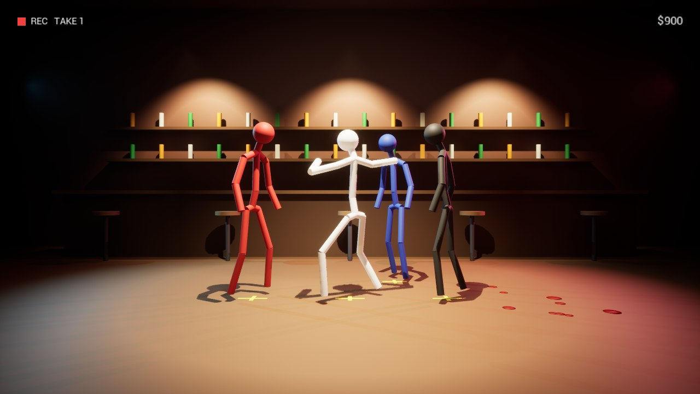
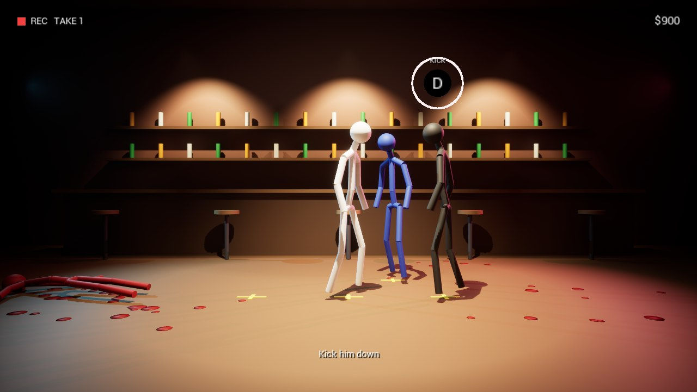

- **Developer said:** "Yes, scene two". And, in six messages while the agent worked: the replay must be more cinematic, with music, sound effects and movement; scenes must be logical and tell a story, such as a hostage or child rescue, with fights using guns, hands or things in the set; passing a scene should pay money and unlock the next; think of better fight animation, physics and effects; and make fights against several opponents smoother, with better transitions between enemies, movement speed and responsiveness.
- **Agent did:**
  - **Scenes are text files.** `Content/Scripts/Scene01.json` and `Scene02.json` hold the beats, the stage, the fee and what a cut costs. A new fight is a new file and needs no compile. An automated test loads every scene file and checks every beat.
  - **A game around the scenes.** Title card, scene card, the shoot, the film, a pay card, then the next scene's level, and a results card at the end. The pay for the take in progress shows at the top right and drops with each "Cut!".
  - **Scene 2, the bar.** Ten beats against three opponents, one on each side of the player and one behind. The player's fighter turns to face whoever the beat is with. One beat asks the player to hold still: pressing nothing passes it, and any key is a cut.
  - **The bar itself,** generated like the first stage: counter, bottle shelves lit from above, stools, tables, a warm lamp over the fight and a red and a teal glow from the ends of the room. The two stage scripts now share one helper file.
- **How it was verified:** the whole game was run on autoplay in the editor, with a frame every two seconds, and then again as a packaged build. The log shows title, scene 1, film, pay, the bar, film, pay, results, in that order. The second packaged build (632 MB) loads the bar and reaches the results card with no errors in its log.
- **Went wrong:**
  - **An opponent fell four beats early.** In the first run of the bar scene the third opponent was on the floor by the middle of the fight. The events in the log matched the script exactly, so the script was not the cause. The cause was the loader: the game loaded a scene file over the built-in scene, and the JSON reader keeps the old value of any field a beat does not mention. The built-in scene's sixth beat is a knockout, so the bar scene's sixth beat inherited one. Found by looking at a frame, not at a test. The loader now starts from an empty scene, and a test loads every scene over a dirty one to prove it.
  - **The bar was missing from the packaged build.** In the editor everything worked. In the package, scene 2 was played in the warehouse: the game asked for the bar level, did not find it, and fell back to the first level without stopping. Unreal's "always cook this folder" setting covers ordinary assets but not levels, and a scene file names its level as plain text the cooker cannot follow. The level is now listed, and the packaging script fails if any scene's level is absent from the build. The new check was tried against the bad build first, and reported the missing level.
  - A shell quoting mistake mangled the packaging script while that check was being added. The agent rewrote the file whole.
- **Answer to the developer's requests:** money per scene and moving on after a clean take are in this build. The rest is written into the plan as the next block of work: a cinematic film with camera movement, speed changes and music; one story across the scenes, a rescue, with a gun, a prop and a hostage to free; and a fight-feel pass for kicks, physical staggers, things that break, and smoother movement between opponents.
- **Not verified:** playing the bar scene by hand rather than on autoplay; failing the hold-still beat on purpose; and the sounds by ear.

### 16:10–16:13 · A reference from the developer: fights that flow

- **Developer said:** "i got inspired by this video", a link to the Flash animation Xiao Xiao No. 3, and asked how the agent could see the smooth animation and the way they fight, to get the idea.
- **Agent's honest answer:** it cannot watch motion. It opened the page in the browser, paused the video and stepped to eight moments, looking at one still frame from each. That shows the staging, the poses, the camera and how many opponents are on screen. It does not show timing.
- **What the agent took from it:** the hero moves through a building and the fight moves with him; opponents arrive a few at a time through doors and last one to three moves; the fallen stay on the floor; the hero is never idle; fast strikes are drawn with a smear; the camera is wide for the crowd and close for the last duel.
- **What that means for this game:** today three opponents stand on marks and wait their turn, and the player turns on the spot. The reference says a fight should be a run through a space. That is now a task, `S2-FIGHT-03 Fights that flow`: fighters that travel between beats, opponents that enter, cross-faded moves, a camera that follows, and a closing duel. It is an idea to learn from, not content to copy.
- **Went wrong:** the agent wrote this entry's time and the previous one's ahead of the clock, from memory. Both were corrected against the system clock a minute later. A shell quoting slip also dropped the task's name from this entry, now restored.
- **Not done:** none of it is built yet. This entry records the direction.

### 16:13–16:33 · Fights that flow, built; then the developer throws the script away

- **Developer said:** "Yes, flow first". While it was being built: "instead of guiding the player where to click and how to fight, make it a full free move scene", and then, firmer: "more of a free fight like street fights, no more button animation or view circle, u roam around and hit everything in your way ... no guide no one tells u what to do, we call it as u dont stick to script and u rebel".
- **Agent did, for the flow step:** fighters can travel (`MoveTo`, with the mannequin's jog animation), opponents wait behind cover and run in when their part starts, joints cross-fade between moves, a fast hand or foot leaves a smear, the playing camera slides along with the player and moves closer for beats marked as a close-up, and the film carries its close and low cameras to each strike. Both scenes were rewritten for four opponents each (11 and 14 beats) and the warehouse was regenerated as a 30 m set with crate cover.
- **Result:** `Tools/check.ps1` passes with 5 tests. On autoplay, scene 1 ran clean in 20 seconds across the whole set and the film started. Frames show the run between opponents, the entrances from the crates, the camera keeping up and the closer final duel.

- **Agent's opinion on the change, given when asked:** agreed. Prompts make the player a button-presser and the film the same every time. A free fight makes each take, and so each film, the player's own, which is the theme. The title turns into the joke: the script says one thing and the player does another.
- **What survives:** everything in this step except the beats themselves. Travel, entrances, the cross-fade, the travelling camera, the long set, the recorder and the film do not care who decides the next move.
- **Went wrong / not verified:** the smear was never seen in a captured frame. Scene 2 was not played on this build, and nothing was packaged, because the next step changes how both scenes are played. The task closed with two boxes open and says so.

### 16:36–17:38 · The script goes in the bin: a free fight

- **Developer said:** "more of a free fight like street fights, no more button animation or view circle, u roam around and hit everything in your way, u go back and forward jump crouch and throw objects ... no guide no one tells u what to do, we call it as u dont stick to script and u rebel". Then: "would the free fight plan still fight the jam theme idea? what would u add to it to make it fit?" And a hard rule on cost: "never use extra credit, stick to regular limit".
- **Agent's answer on the theme:** it fits better, if three things are in. The film stays, and is now different every time. The director becomes a character: a card says what the script wants (you lose) and he protests when you ignore it. And pay should score the film, a "box office" figure, instead of only counting retakes. The first two are built. The third is a proposal.
- **Agent did:**
  - Free movement, strikes that find their own victim, health, stagger and knockback on the fighter. A procedural kick, because the engine ships none.
  - Opponents that think: four kinds (thug, rusher, kicker, heavy); at most two attack while the others hold a side and wait; some raise a guard when they see a strike coming.
  - The director became a referee: every opponent down is a wrap, the player down is "Cut!".
  - Crates and bottles to pick up and throw, recorded for the film.
  - A health bar, the director's shouts, the script card, and both scenes rewritten with six opponents each.
- **Result:** `Tools/check.ps1` passes with 6 tests. A self-playing test fighter got through both scenes, a knockout, a retake and both films. A hand-played test with real key presses picked up the crate, threw it and kicked.

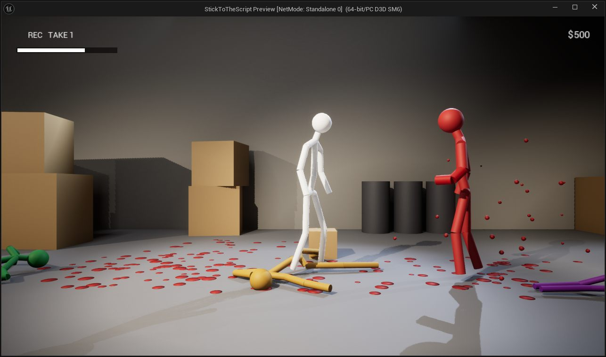

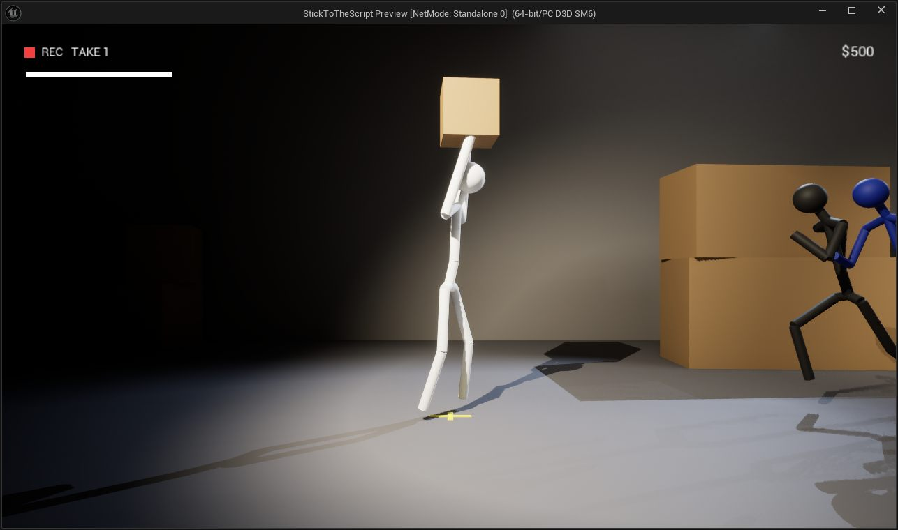 

- **Went wrong, and the developer caught most of it by watching:**
  - **"he is kicking from a far distance, like kicking the air but i see hit effects at the enemy."** True. Blows were allowed to land from further than the animation reaches, and the "kick" was still the charged punch. Reach now comes from the animation, the fighter steps into the strike, and the kick is a leg.
  - **The same report again.** The agent found a second cause in a frame: after a kick landed the fighter turned to its next target with the leg still out. A strike now snaps to its target and holds that facing.
  - **And a third time.** Instead of guessing again, the agent made the game log every blow: how far the fist or foot stopped from the body. Over a full fight the median was 8 to 17 cm. So punches and kicks were honest, and what looked like air punches was the crate throw, which used a punch motion and flew too fast to see. It got its own two-handed motion and a slower crate.
  - **"we need to control the fighting, or ur idea is the fight is auto?"** The developer had only seen the agent's self-playing test mode, because the agent cannot hold keys down. The switch was on the P key and toggled; it is now F9 on, F10 off, and the controls are shown at the start of every take.
  - The agent stopped at 95% of the 5-hour usage limit to keep the cost rule, with the code written as edit scripts and nothing applied. One script then failed half way on a wrong indentation and left the tree part-edited. Later scripts check every change before writing any file.
  - A shell pipe ended a test run early and left the game playing itself in the editor while the developer watched.
  - A light stand in front of the travelling camera crossed the picture as a black bar. It was moved behind the camera.
- **Not verified:** walking, ducking and guarding by hand (they need held keys); the jump kick (one frame, hidden behind an opponent); props in the film; bottles in the bar; a gamepad; how hard it is for a person; and the packaged build, which has not been made since the change.

### 17:40–18:15 · The packaged build finds what the editor had hidden

- **Developer said:** "Yes, package it". And while the packaged game was running: "current running test i saw the player walking in the air, flying not at ground".
- **First package: it did not compile.** Two source files each defined a helper called `IsAutoplayOn`, and two more each defined `Gravity`. A clean build compiles source files merged together, so the names clashed. The day-to-day check had passed six times on this code, because the build tool compiles files with local changes one by one and never put them side by side. So `main` could not be built from a clean checkout for 9 minutes, from the merge at 17:40 to the fix at 17:49. The helpers now have one home or their own names, and `Tools/check.ps1` passes `-DisableAdaptiveUnity`, so the check always builds the way a clean checkout does.
- **Second package: it ran, and the developer saw a fighter walking above the floor.** The agent did not guess this time. It added a self-check to the game: any fighter with both feet off the floor and no jump to explain it writes a line saying where its body is. Within a second of a retake it wrote one: the visible body was sitting about a metre to the side of the fighter and 35 to 55 cm up. That is where its ragdoll had come to rest in the take before. The call that puts the body back does nothing if the body never detached, so it had stayed there.
- **This very likely explains the earlier reports too.** Three times the developer said blows were landing from a distance. Every fighter knocked out in an earlier take was being drawn a metre away from where the rules had it, so of course hits looked wrong. The agent's measurement in the entry above was correct, but it was taken in a first take, before anyone had been knocked out. It measured the honest case and told the developer the matter was settled by the crate throw. It was not settled.
- **Fix and proof:** one line puts the body back. Then the fighter was left standing with nobody at the keys: knocked out four times, and on take 5 it stands on its mark with its feet on the floor, and the self-check stayed silent.

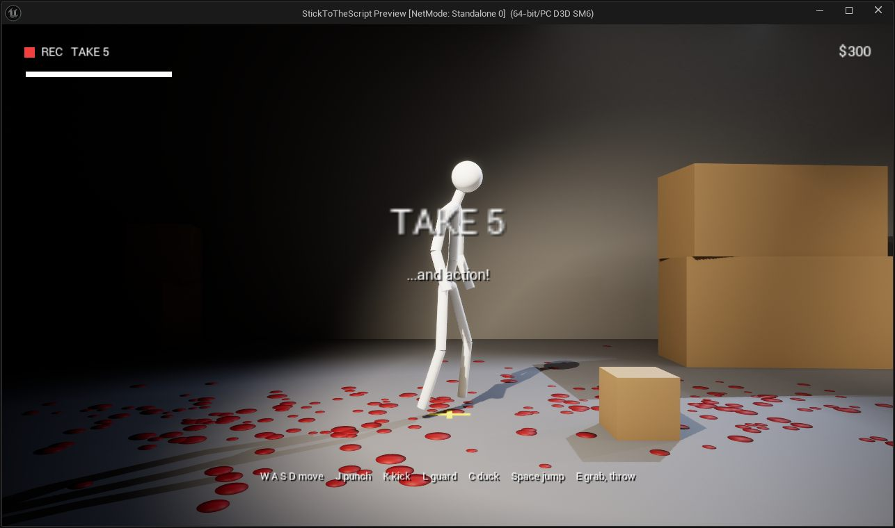

- **Third package:** passes, 632 MB, no editor-only plugins, both levels inside. The packaged game played itself through both scenes and both films with no report from the self-check and no error in its log.
- **Not verified:** a knockout and retake inside the packaged game after the fix (the test fighter happened to win both scenes first time there; the retake was proven in the editor). Everything that needs a person at the keys is still open.

### 18:15–18:35 · Box office: the pay scores the film

- **Developer said:** "Yes, box office", to the agent's proposal from earlier: pay for how good the film is, not only for surviving.
- **Agent did:** every blow the player lands during the shoot now earns money, and the same kind of move stops paying after three in a row until something else is used. A thrown prop, a blow from the air and a stopped blow pay most; each extra kind of move adds a bonus at the end. The figure at the top right climbs as it is earned, with the last thing earned under it, and the pay card after the film says what the audience paid for.
- **Result:** `Tools/check.ps1` passes with 7 tests; the new one covers the rules. On self-play the warehouse card read: "First take: the full fee, $500. Box office: $334. 6 knockouts, 1 thrown, 3 kinds of move. You made $834." The packaged build (632 MB) played the whole run by itself and its results card read: "Fees: $1400 of the $1400 offered. Box office: $585. You made $1985."

- **Why it matters for the theme:** in a free fight nothing made the player care how the film looked. Now mashing one button wins the scene and earns almost nothing, and a fight worth watching earns the most.
- **Went wrong:** nothing broke this time. One thing was caught before it could: the film replays every blow through the same event, so the score only listens during the shoot, or every scene would have been paid twice.
- **Not verified:** the amounts are guesses that only the self-playing fighter has tried. The results card at the end of a run was seen in the packaged game. Jumps and guards by a person have never earned anything, because the test fighter does neither.

### 18:35–19:08 · The film gets an edit, slow motion and music

- **Developer said:** "Yes, the film", to the agent's offer to make it cinematic. The request behind it, from earlier in the day: the replay "need to be more cinematic, with nice music and action and sounds effects and related moves, smooth and fun".
- **Agent did:**
  - The film is now an edit instead of a replay. It keeps the first blow, every knockout and every thrown prop with room around them, then fills up with kicks and stopped blows, and cuts out the rest.
  - It slows down into the last knockout and into every thrown prop. Close shots creep in on what they look at.
  - Punch skips the film, but not in its first three seconds, because the player is usually still hitting keys when the last opponent falls.
  - Music, made in code like every other sound: a kick drum, a bass, a hat, a snare and a thin lead in A minor. A bare pulse plays under the fight and the whole band, faster, over the film.
- **Result:** `Tools/check.ps1` passes with 8 tests; the new one feeds the editor a made-up minute of fight and checks what it keeps. A 36-second fight made a 21-second film. The skip test let the game reach the film and pressed punch: the film ended 5.7 seconds after it began. The packaged build passes at 632 MB and plays with the music running.

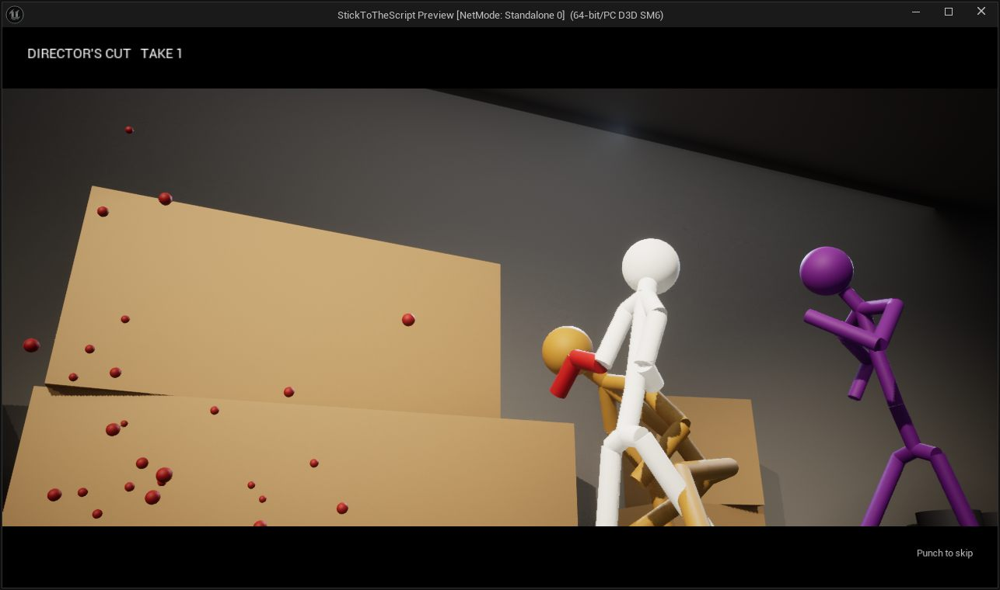

- **Went wrong:**
  - The first cut was barely a cut: 33 seconds of film for a 41-second fight. Six knockouts each took a 2.7-second window and a slow run-up. The windows were shortened and only the last knockout keeps the run-up.
  - The low camera sat so close that two bodies filled the picture. It was moved back.
- **What the agent cannot do:** hear. It knows the music reaches the mixer, from one log line. Whether it is any good, too loud, or annoying after a minute is for the developer's ears. The same was already true of every hit sound in the game.
- **Not verified:** the music by ear; whether slow motion bends the music's pitch (it is flagged not to); the film in the bar scene; a camera ending up inside a wall or a crate.

### 19:09–19:41 · A story, a third scene, guns and a kid to rescue

- **Developer said:** "Story, scene 3". And while it was being built: "how many scene should we make ?"
- **Agent's answer:** three. One short film in three acts, each on a different set with one new threat: fists in the warehouse, a crowd and bottles in the bar, guns and a boss on a roof. Three finished scenes beat five thin ones, and a full run stays near five minutes.
- **Agent did:**
  - The story, told by the cards: the gang has a witness's kid. The script has the hero beaten in the warehouse, knocked out in the bar and too late on the roof. The player has other ideas, and the last card now ends: "In the script, the kid is never found. In your cut, the kid goes home."
  - The rooftop, generated like the other sets: a roof at night, a water tank, a helipad, and a skyline of towers with lit windows.
  - Gunmen. A red line shows the aim, follows the player, then holds still for a moment before the shot goes where it was held. Duck under it, step out of it or jump over it.
  - The kid: a small yellow figure cowering on the helipad, out of everyone's reach, who stands up when the last opponent falls.
- **Result:** `Tools/check.ps1` passes with 8 tests. On self-play the rooftop was won on the fifth take; the pay card read "Fee $1400, less 4 retakes: $1000. Box office: $376", and the kid is standing on the helipad behind it. The packaged build (632 MB) played itself through the first two scenes and reached the rooftop after 200 seconds, where the gunmen fired, with no errors in its log.

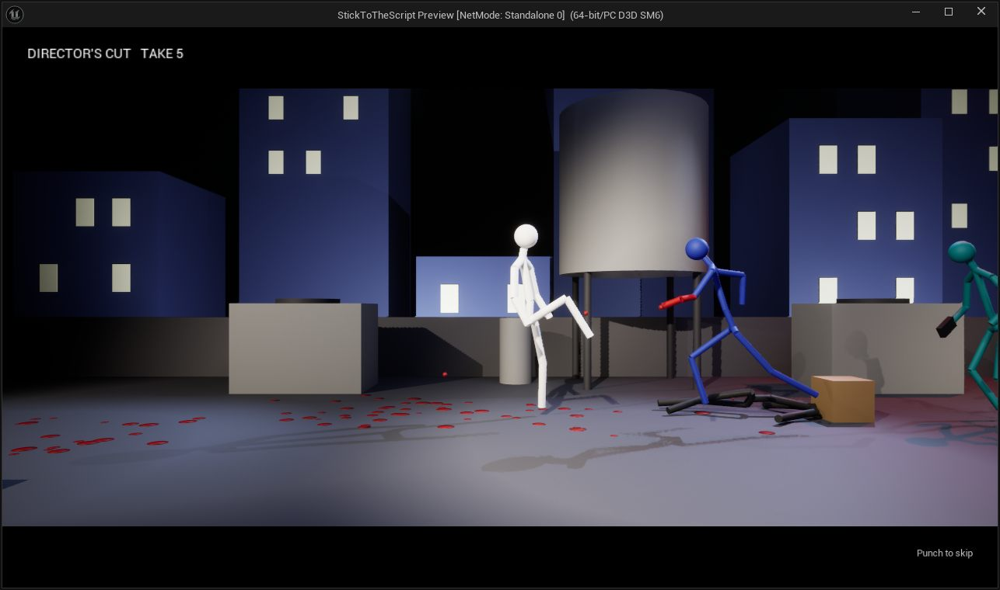

- **Went wrong:**
  - The first rooftop was washed out to white. The one strong light meant for the towers behind was lighting the roof too. It became two lights below and behind the roof's edge, where the roof cannot be in their beam.
  - The test fighter lost every take, twice over: first because it never ducked a shot, then, once taught to duck, because it ducked the whole time a gun was pointed at it and never fought. It now ducks only just before a shot. On that evidence the scene was softened: one opponent fewer, gunmen slower and weaker. That is tuning to a test fighter, not to a person.
  - No editor tool opens a level, so reaching scene 3 meant playing two scenes first. The keys 1, 2 and 3 now jump to a scene, but only with self-play on.
  - One compile error: a local variable named `Thickness` hid a class member.
- **Not verified:** whether a person can read the aim line and duck in time; how hard the rooftop is by hand; the gunshot by ear; and the kid standing up was seen after the fact, not watched.

### 19:41–19:58 · The wardrobe: the player chooses how they look in the film

- **Developer said:** "Do character look". The wish behind it, from earlier: let the player customise their character simply, "and later show that exact character in the video to make it feel like u really did the scene".
- **Agent did:** a wardrobe step after the title card. The player's fighter stands on the set, with no dark card over it, and three choices change it as they are made: a colour out of eight, a hat out of five (a hat is one or two plain shapes set on the head), and a build out of three. The look is kept for every scene. The film poses the same fighter, so the film shows it without any extra work.
- **Result:** `Tools/check.ps1` passes with 8 tests. Played by key presses: Chalk to Sky to Lime, no hat to cap to top hat, regular to heavy, then into scene 1, where a lime fighter in a top hat throws a kick.

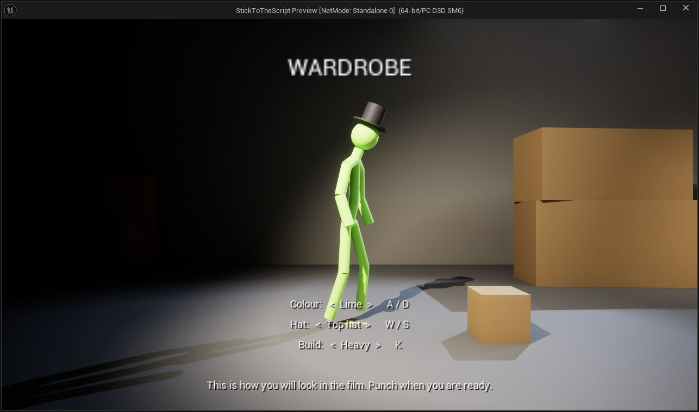

- **Went wrong:** the first three test runs seemed to show any key closing the wardrobe. The game was right and the test was wrong: the mouse click the test uses to focus the window is a punch, which answered the title card, so the test's next key press closed the wardrobe it thought it was opening. Found by reading the event times, not by guessing: the wardrobe always closed exactly as long after opening as the test waited between two of its keys.
- **Not verified:** the hat in a film; the look across a change of scene; the other hats and colours by eye. The look is not saved between sessions.

### 19:58–20:11 · A first look pass: rounder figures, a stance, a film look

- **Developer said:** "u need to polish and improve graphics and assets and character, animation, make the game look nice for now while i test and play soon".
- **Agent did:**
  - Figures: a ball at every joint so limbs no longer end in flat cuts, bigger balls for hands and feet, a thicker trunk, and two eyes placed from the shoulders so they show which way a figure faces, in play and in the film.
  - A stance: a fighter standing still keeps its hands up, instead of the slack arms of the engine's idle animation.
  - The picture: every set is regenerated with glow on lights, film grain, a little colour fringe, and stronger contrast and colour.
- **Result:** `Tools/check.ps1` passes with 8 tests, and all three sets were rebuilt. The packaged build passes at 632 MB; run on self-play for two minutes it showed the wardrobe, played three takes and a film, with no errors.

- **Went wrong:** the text. The cards are drawn from a small bitmap font scaled up, and it is soft. The agent switched every text call to the engine's outline font at the right size, and the result was no text at all: no take number, no pay, no wardrobe labels. It was seen in the first frame and taken back out, so the soft text is still there. Why the outline font drew nothing is not understood.
- **Not done:** sharp text; a backwards walk for opponents who retreat; better-looking props. This is a first pass, not the finish.
- **Not verified:** the new figures in a film; the look of the bar and the rooftop after the change (only the warehouse was looked at); whether the grain and fringe are too much. That last one is taste, and it is the developer's.

### 20:11–20:42 · "graphic is so poor": sharp text, breaks that read, things to throw

- **Developer said:** "Yes, keep polishing". Then, with a screenshot of the title card from the packaged game: "graphic is so poor". Then: "broken parts is also very poor need to look better"; "and keep in mind adding more funny throwable items"; and, with a second screenshot: "strange broken parts flying".
- **The developer was right about the title card.** It was a wall of soft text over a dimmed figure. The softness was the bitmap font, scaled up six times.
- **Sharp text, second attempt.** The first attempt, an entry ago, drew nothing and was taken out without knowing why. This time the agent read the engine's source instead of guessing. The canvas text item has a check, `HasValidText`, that returns false when no font object is attached, even if an outline font was passed in to be used. An empty font object marked as cached at run time is now attached, and every line of text in the game is drawn at its real size.
- **Also done:** a short title card with a red rule, and cards that let more of the set through. Broken arms keep their colour and show a sharper kink, a pale spike of bone and a wound. A struck figure flashes white. Opponents backing away walk backwards. Crates have straps, bottles a neck and a label. Three more things to throw: a watermelon that bursts, a traffic cone, a frying pan.
- **Result:** `Tools/check.ps1` passes with 8 tests. The packaged build passes at 633 MB; on self-play for two minutes it played two takes and a film, landed two thrown objects, and logged no errors.

- **Went wrong:** the new bone and wound pieces were left hanging in the air over every knocked-out fighter who had a broken arm. The developer's second screenshot showed five of them. The pieces were only hidden when an arm's state changed, and a knocked-out fighter stops reporting its breaks without that change ever being seen. They are now set every frame. The agent had looked at a frame before that screenshot and not noticed them.
- **Not verified:** the watermelon and the frying pan being thrown (only the cone was seen, lying on the floor); the backwards walk in a frame; the title card itself after the change (the test's first click skips it); the bar and the rooftop.

### 20:42–20:45 · The developer's idea: a skeleton flash on every hit

- **Developer said:** "can we show a skelton instead of the white flash at each hit? a flash of skelton inside each character?"
- **Agent did:** for the instant of a hit a figure is now drawn as its own X-ray: its limbs thin down to pale bones, its joints shrink to knobs, three ribs show across the chest, and its eyes widen into dark sockets in a pale skull. It replaces the white flash, and it plays in the film too, because the film marks each replayed hit the same way.
- **Result:** the check passes with 8 tests.
- **Not verified:** the agent took 24 frames a third of a second apart during a fight and the one it looked at fell between hits, so it has not seen the skeleton. The flash lasts about an eighth of a second. The developer is watching the game and will see it before the agent does. Not packaged: the packaged build is one step behind.

### 20:45–21:03 · Legendary drops: a golden hammer for every second knockout

- **Developer said:** "spawn legendary throwable or holdable and hittable items after knocking out enemies, the strongest items will hit and knock and apply physics to the enemy".
- **Agent did:** a golden hammer falls where the second and the fourth opponent of a take are knocked out. It can be held and swung with punch, or thrown. Either way one blow knocks its target out and throws the body across the set, and it reaches further and hits everyone in front of it. It breaks after three blows. Two are made at the start of every scene and hidden under the floor, so the recorder has them from the first frame and the film can show them.
- **Result:** the check passes with 8 tests. On self-play the warehouse ran to the end: six knockouts, the take finished, the film played.

- **Went wrong:** the first test stalled after one knockout. The hidden hammers wait under the floor at the start position, and picking up measures distance along the floor only, so the test fighter took a hammer through the floor in the first second. A prop in reserve can no longer be picked up. A person pressing E at the start would have found the same hole.
- **Not verified:** the agent has not seen the hammer: not falling, not held, not swung, not a body flying from it. It is not packaged. Only one legendary item exists, and it is the same in every scene.
### 21:03–21:30 · One legendary drop a take, picked at random, gone once thrown

- **Developer said:** after trying the hammer in the editor: "looks good but it should spawn once, and random with other items and disappear after it fall". Then: "lets pause after this merge push".
- **Agent did:** one legendary item a scene instead of two. It is a golden hammer, a golden bat or a golden fish, picked at random when the scene loads, and it drops after a knockout chosen afresh each take, never the last. Once thrown it is gone when it lands. Held, it still breaks after three blows.
- **How the agent read "disappear after it fall":** as "after it has been thrown and comes down". An item that has dropped and not yet been picked up stays where it fell. If the developer meant that an unclaimed drop should vanish too, that is a one-line change.
- **Result:** the check passes with 8 tests. On self-play the warehouse ran to the end: six knockouts, four thrown hits, the take finished, the film played.
- **Not verified:** the agent has not seen the bat or the fish, or a thrown legendary item vanish. The developer saw the hammer and said it looked good; nobody has looked at this change. Not packaged: the packaged build has neither the legendary items nor the skeleton flash's last fixes.
### 23:57–00:09 · A menu, a pause and a way out (past midnight, into Fri Nov 13)

- **Developer said:** "what would we do next?" The agent proposed repackaging first, so the developer could play by hand. The developer picked the other button: "Menu and quit first".
- **Agent did:** the title card is now a menu: the three scenes, credits, quit. A scene is locked until the one before it is wrapped, and the money from every wrapped scene is banked and shown on the title. The developer had asked for the unlocking and a saved total earlier in the day. Both are kept between sessions in the player's settings file, which needed no save-game class. P or Esc pauses a take or its film: resume, back to the menu, quit. The results card now goes back to the menu.
- **Decided by the agent, not asked for:** with self-play on nothing is locked, so a test can start at any scene. The credits card says "Directed by one human. Built with an AI coding agent, Claude Code." The developer has not read it.
- **Result:** `Tools/check.ps1` passes with 8 tests. Then a run by key presses in the editor: paused a take, went back to the menu, tried a locked scene (nothing happened), opened the credits and came back, played, paused and resumed, let the test fighter wrap the warehouse, found scene 2 open and $813 in the bank on the title, picked scene 2 (its wardrobe opened in the bar), paused and quit. The play session ended.

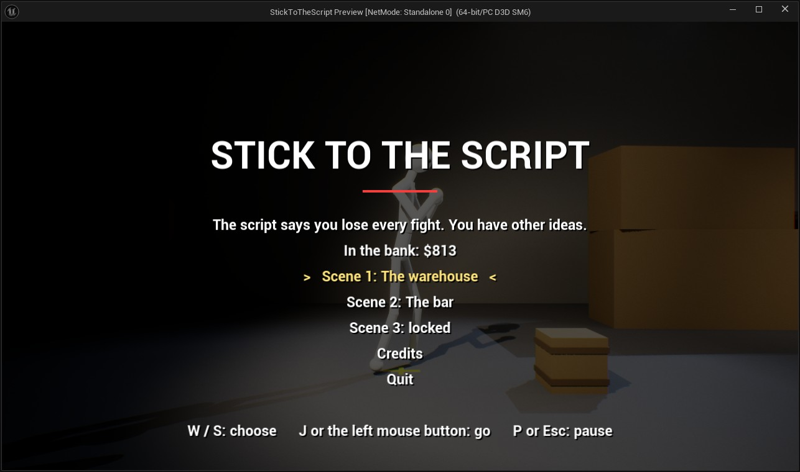

- **Not verified:** Esc (in the editor it ends the play session, so only P was pressed); a gamepad; the Quit row on the title (it makes the same call as the pause menu's); the results card going back to the menu; scene 3 unlocking; anything in a packaged build. No automated test covers the menu.
- **Left behind:** the editor's settings file now has scene 2 open and $813 banked by the test fighter, not by the developer. A packaged game writes its progress into its own `Saved` folder, so the release zip must be made without that folder; that is now a box on the release task.

## Day 2 — Fri Nov 13, 2026

### 00:37–00:42 · Packaged with the menu and the legendary items

- **Developer said:** "Yes, package it".
- **Agent did:** ran `Tools/package.ps1` (the developer had already closed the editor), then ran the packaged game for 32 seconds on self-play and read its log.
- **Result:** packaged in 168 seconds: 633 MB, no editor-only plugins, all three levels inside. In the run: the title menu, the wardrobe, the scene card, take 1 and "action", with no errors in the log. The run was stopped before any scene was wrapped, so this build has no saved progress and the developer starts with scenes 2 and 3 locked.
- **Not verified:** anything past the first seconds of the first fight in this build. The agent read a log; it did not see the picture or hear the sound. Esc as the pause key is still untried.

### 00:53–01:21 · The player cuts the film

- **Developer said:** "what else should we continue with? i will play and test later". The agent proposed letting the player choose how the film is cut, as the weakest point against the theme: the script was the player's to ignore, but the film was still edited for them. "Yes, build it".
- **Developer asked, mid-task:** "do u see that our game is going in the right direction with chance to win sth at the jam?" The agent's answer: the direction is right, because the theme is in the mechanics and the game was whole on day 1. The best chance is the Glass Box prize. The visuals are weak, and the feel and the audio are unknown because nobody has played by hand. The overall win is unlikely for a solo entry with simple art.
- **Agent did:** after a wrap a card titled DIRECTOR'S CUT says "The director has walked off the set. The cut is yours." It offers the action cut (the edit as it was), the slow-motion cut (every knockout slowed, not only the last) and the long take (the whole fight from one camera, run 1.6 times as fast). The film's title bar names the cut. The film no longer starts by itself: the flow starts it with the cut that was picked. A key pressed in the first 0.6 seconds of the card is ignored, because a player is often still punching when the last opponent falls.
- **Result:** `Tools/check.ps1` passes with 8 tests; the film's test now covers the long take. In the editor: the action cut picked by key presses in the warehouse ran 21.6 s; the slow-motion cut picked by the test fighter in the bar ran 24.8 s; the long take picked by key presses in the warehouse ran 30.3 s. A golden item that looks like the fish was seen for the first time, lying on the set in the long take. Packaged afterwards (633 MB); the packaged game ran 30 seconds on self-play into the first fight with no errors and no saved progress.

- **Went wrong:** the first run was meant to show all three cuts over all three scenes. The test fighter went down 12 times in that run and never wrapped the rooftop in the five minutes the test waited, so the long take was seen in the warehouse instead and the results card is still unseen since the menu went in. Whether the rooftop is too hard for a person is for the developer's playtest.
- **Found on the way:** in the bar, a frame of the film was two thirds black. The floor camera had been put under a table that stands beyond the end of the arena. This was not caused by the change; the film in the bar had never been looked at. The floor camera is now kept inside the ends of the arena. In a second film in the bar, 29 frames sampled about a second apart showed no blocked shot.
- **Not verified:** any cut on the rooftop; how the three films feel at speed (the agent sees still frames); the long take of a long fight. Fighters at the ends of the bar are dark in the film, lit only from behind. That is the stage's lighting and is left for the art pass.

### 01:32–01:35 · Ship prep: the release zip and a store page draft

- **Developer said:** "Yes, ship prep".
- **Agent did:** wrote `Tools/release.ps1`, which zips the packaged game as TeamName_StickToTheScript.zip without the game's `Saved` folder, then checks the zip itself: the game is in it, no saved progress is in it, and it is under the jam's 1 GB. Drafted the store page text in `Docs/StorePage.md`: description, controls, how it was made, and what goes into the jam's form.
- **Result:** a zip made with a stand-in team name came to 360 MB (the packaged folder is 633 MB) in 37 seconds. A team name with a space in it was refused. The zip was extracted and the game run from the extracted copy for 30 seconds on self-play: no `Saved` folder before the run, the title menu with scene 2 locked, into the first fight, no errors.
- **Not verified:** a second machine. The gamepad column in the controls: no gamepad has been tried.
- **Open, for the developer:** the team name; screenshots (those in this log show the editor's window frame and are not fit for a store page); the video; and a public home for this log, since the repository is private.

### 01:35–01:51 · The old prompt game is deleted

- **Developer said:** "Yes, clean up", to the agent's question whether to delete the old prompt and beat code and treat the free fight as final. The developer has not yet played the free fight by hand; a note in the plan had said to wait for that.
- **Agent did:** deleted the cued-beat game. Gone are the beats in a scene, the director's judging of moves, the three beat events, the key-prompt circles on the screen, the opponents' scripted side of a beat, strikes with a chosen victim, the camera's close-up for a beat, and the tests of all that. 23 files, 821 lines out and 83 in. A take can now be cut for one reason only: the player went down.
- **Kept on purpose:** the switch that makes a fighter cycle through its moves to be looked at, and the fallback that stands opponents on a level's tagged marks when a scene lists none.
- **Result:** it compiled on the first try. `Tools/check.ps1` passes with 6 tests, down from 8: the two that went tested the old judging rules. A self-played fight in the warehouse in the editor: six knockouts, the player never down, the take wrapped, the long take played for 25.7 s, no errors. Packaged afterwards (633 MB); the packaged game ran 40 seconds on self-play into the first fight, with 25 blows landed and no errors.
- **Not verified:** the bar and the rooftop since the deletion. The same code runs all three, but only the warehouse was played.

### 01:51–02:07 · Lamps over the ends of the bar

- **Developer said:** "Yes, fix the lighting", to the agent's question about the dark ends of the bar it had found while checking the film.
- **Agent did:** the bar had one lamp, over the middle. A fighter at either end of the arena was lit only from behind by the red or the teal glow. The stage script now hangs three lamps in a row, the brightest in the middle, and the level was rebuilt from it.
- **Result:** in a self-played film in the bar, 23 frames sampled about a second apart all show the fighters lit, at the ends as well. A golden bat was seen in a fighter's hands for the first time. `Tools/check.ps1` passes with 6 tests. Packaged afterwards (633 MB); the packaged game ran 30 seconds on self-play into the first fight with no errors.

- **Not verified:** the frame rate with two more shadow-casting lamps. The rooftop and the warehouse were not checked for the same fault.

### 02:07–02:17 · The same fault in the other two stages

- **Developer said:** "Yes, check them".
- **Agent did:** worked out from the stage scripts where each lamp's pool falls. The rooftop's four pools cover its arena. The warehouse's four stop about 2 m short of the left end of its arena, where a fight ends up if the player backs away from the first opponents. Added a fifth pool there, with its lamps turned round because the wall is too close on that side, and rebuilt the level.
- **Result:** the warehouse's left side, black before, now shows the floor and the crates. On the rooftop, twelve frames of a self-played fight all show the fighters lit, so nothing was changed there. `Tools/check.ps1` passes with 6 tests. Packaged afterwards (633 MB); the packaged game ran 30 seconds on self-play into the first fight with no errors.

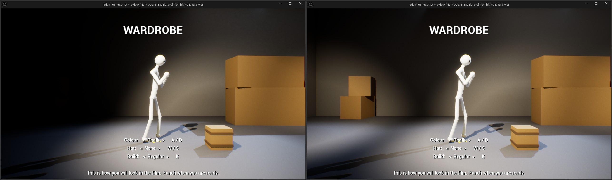

- **Not verified:** a fighter standing at the warehouse's left end. The agent cannot hold a key down to walk there, so it saw the lit floor and not a figure on it. The last 70 cm at the right end of the warehouse is still outside every pool. The frame rate with the extra lamps was not measured.

### 02:17–02:33 · Takes on the results card, and a measure of the rooftop

- **Developer said:** "Yes, add them", to the last small item that needed no playtest.
- **Agent did:** the results card now has a line with the takes each scene needed, for example "Takes: scene 1 in 2, scene 2 in 1, scene 3 in 5". A scene skipped by starting further on from the menu is left out of it.
- **Result:** `Tools/check.ps1` passes with 6 tests, one of which now checks that line. Packaged afterwards (633 MB); the packaged game ran 30 seconds on self-play into the first fight with no errors.
- **Not verified:** the card on screen. The results only come after the rooftop, and the test fighter played the rooftop for nearly seven minutes, went down 11 times and never wrapped it.
- **What that run measured:** in those eleven takes the test fighter put down three of the six opponents five times and four of them six times, never five. With the earlier run that is 23 times down and no wrap in about twelve minutes. The test fighter never guards and only ducks a shot, so this is not what a person would do, but it is the only evidence there is until the developer plays.

### 02:33–02:52 · Retakes tire the opponents

- **Developer said:** "Yes, ease it off", after the agent showed that the test fighter had gone down 23 times on the rooftop without finishing it, and that a judge who cannot finish scene 3 never sees the ending.
- **Agent did:** the first three takes of a scene are fought at full strength. From the fourth, the player takes 15% less damage with every retake, down to 40% of it from the seventh on. The take's slate then says in gold: "The stunt crew is getting tired. They hit softer now." A player who wins early never sees it.
- **Result:** `Tools/check.ps1` passes with 7 tests; the new one checks the rule. Then the rooftop on self-play: this time the test fighter wrapped it on its second take, the first wrap of the rooftop since the menu went in. The results card's text was read from the log: "Fees: $1300 of the $1400 offered. Box office: $382. Takes: scene 3 in 2. You made $1682." The run then went back to the menu by itself and on through the warehouse into the bar, which is the first time the way from the results back to the menu was walked.
- **Went wrong:** the test script waited for a fourth take before it took its picture of the results card. No fourth take came, so the picture was taken minutes later, of the bar.
- **Not verified:** the easing in play. No scene reached a fourth take, so the gold line was not seen, and that a blow really hurts less was not seen either: only the rule is tested. The results card was read as text, not seen.
- **Not packaged:** the developer, watching this run, asked for a change to broken arms. The build is packaged after that.

### 02:52–03:10 · A broken arm does not punch, and arms break less easily

- **Developer said:** while watching a self-played run: "broken arm should not be used to hit after it get broken , and it should not get easily broken".
- **What was wrong:** every heavy blow that did not knock a fighter out broke an arm: every kick, every shot, every thrown prop. And a fighter went on punching with the arm that hung loose.
- **Agent did:** a heavy blow now breaks an arm only if it leaves the fighter at 35% of its health or less. A punch is thrown with an arm that is not broken. The agent turned on the fighter's detailed log to learn which limb each of the three "punch" animations lands with: the right hand, the left hand, and for the third one the right foot. So a fighter with both arms broken still has that one.
- **Result:** `Tools/check.ps1` passes with 7 tests. In a self-played fight in the warehouse, arms broke 4 times, each on an opponent nearly out (2 of 35 health, 7 of 55, 2 of 35, 32 of 170). In five takes on the rooftop, fighters with a broken arm struck 37 times: with the left arm broken, only with the right hand or the foot; with the right arm broken, only with the left hand or the foot; with both broken, only with the foot. The player's own arm broke 6 times in those five takes, always at 35 health or less out of 100. Packaged afterwards (633 MB); the packaged game ran 40 seconds on self-play with 24 blows landed and no errors.
- **Also seen in that run:** the easing from the entry before. The rooftop reached a fourth take, and its slate showed the gold line.

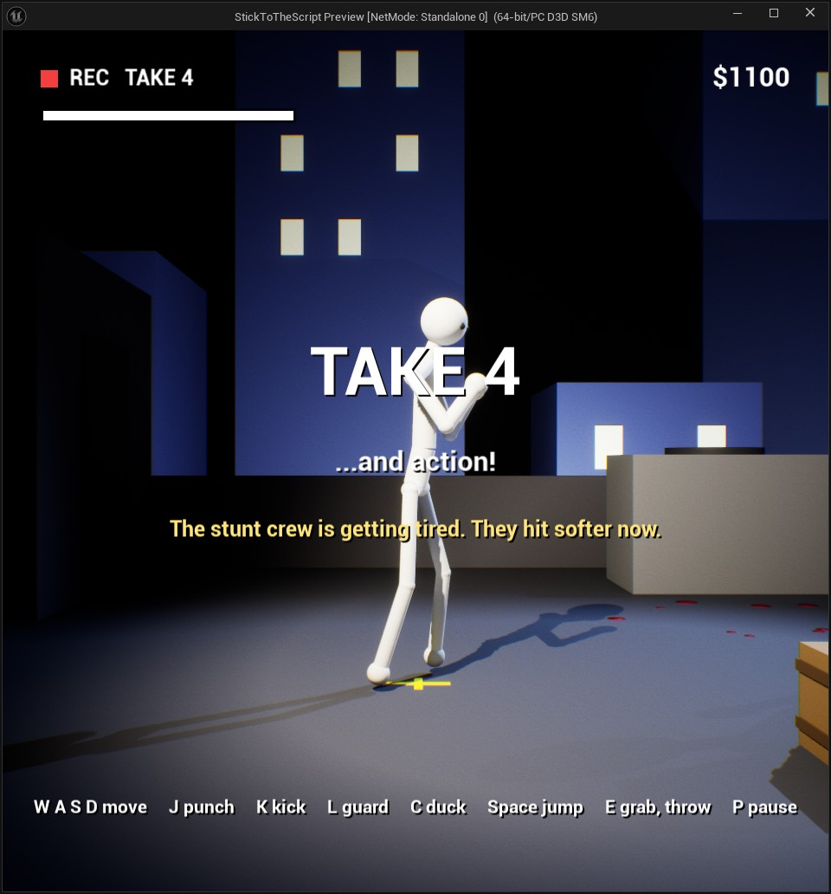

- **Went wrong:** in the first run of this step the test's key presses stopped arriving at the choice of cut, so that run ended there with no film. The cause is not known; the developer was at the machine and may have clicked elsewhere. The choice of cut was not run again afterwards.
- **Not verified:** how it looks. The counts come from the log; the agent did not look at a fighter punching with one arm hanging. Whether 35% is the right line is for the developer to say after playing.

### 03:10–03:30 · The night shift starts: what could stop a judge from playing

- **Developer said:** "if i will go sleep and let u continue and u set pc to sleep when u reach the limit without using extra credit , what would be the steps or stuff that u will work at?" The agent listed checks that need no decisions. Then: "no u can take the weekly limit without any cap , i am off Friday", and that permissions were set to bypass so no prompt would block the night.
- **Then, three requests before going to bed:** "try to improve fighting animation and try to introduce more moves and maybe a climb jump hit where character can use bars to jump and hang at it then jump kick the enemy , just be creative add new moves or karate moves , animation and sounds keep in mind". And: "consider small in game shop to spend the money where u can buy customization for character or tools one time use to fight with like basebat or iron bar or hammer , use better assets and real graphic for the throwable or holdabel". And: "i let u continue now , will check tomorrow".
- **The order for the night:** this entry's safety checks; new moves with their animation and sounds; hanging from a bar and kicking off it; better models for what is thrown and held; the shop; then a long self-played run, a package, this log, a push, and the PC to sleep. No extra credit; usage is checked after every step.
- **Agent did, in this step:** ran the packaged game on self-play and read its log; made the package script put the Visual C++ runtime files next to the game; wrote `Tools/devlog_page.mjs`, which turns this log into one web page with its pictures inside (the repository is private, so the log needs a form that can go anywhere); made the screen text fit a window of any shape.
- **Result, the packaged run:** no errors in seven minutes. Median frame rate at 1280 by 720: 123 in the warehouse, 132 in the bar, 130 on the rooftop, never under 103. The two lamps added to the bar tonight cost nothing that shows.
- **Found, a missing runtime:** the package had no Visual C++ runtime files. On a PC that never had them installed the game would not have started. They are now copied next to the game (638 MB in all), and the package script fails if they are missing.
- **Found, a stuck fight:** the run stopped moving on the rooftop's sixth take with five of six opponents down. The agent captured the game's window to look: the test fighter stood a hand's width outside its own striking distance from a gunman backed into the end of the roof, who would neither shoot from that close nor come closer. This is a fault of the test fighter, which stopped walking at 110 cm and struck from 108; it now walks closer. A person would simply hit the gunman. A cornered gunman doing nothing at all is poor, and is noted for the playtest.
- **Result, the window shape:** in a 960 by 1032 window the controls line had nearly run off the side. The layout now shrinks to the window's width and sits in the middle of its height. Seen on the title, the wardrobe, the scene card, the take slate and the pause menu.
- **Not verified:** the results card in the packaged build, because the run stuck before it. A PC without the runtime: there is none here to try.

### 03:30–03:50 · Four new moves, and a kick that looks like one

- **Developer said (before going to bed):** "try to improve fighting animation and try to introduce more moves ... just be creative add new moves or karate moves , animation and sounds keep in mind".
- **The limit the agent worked inside:** the engine's mannequin brings three attack animations and nothing else. So every new move is posed in code on the sixteen joints, the way the kick already was.
- **Agent did:** no new keys. Ducked (C), a punch is an **uppercut** that throws its victim into the air, and a kick is a **sweep** that takes the legs from everyone round the fighter. Behind a raised guard (L), a punch is a **karate chop** that stuns and goes through a guard, with the other fist pulled back to the hip, and a kick is a **spinning roundhouse**: one whole turn, through a guard and over a ducked head. The plain kick now lifts its knee before the foot snaps out. A waiting fighter rides its knees, and a landing bends them. Each move pays at the box office as its own kind, so mixing them earns the variety bonus. New sounds, all synthesised: a longer whoosh for the spinning moves and a shouted "ha" for the big ones. The crack of a breaking arm now sounds only when an arm breaks; it had gone on sounding on every heavy blow.
- **How the agent looked at them:** a debug key slows every fighter to a fifth of its speed, and a script photographs the player's fighter each time the log says it started a move.

- **Result:** `Tools/check.ps1` passes with 7 tests. In 80 seconds of self-play at full speed: chop landed 4 of 4, kick 8 of 8, roundhouse 3 of 4, uppercut 3 of 4, sweep 2 of 4. A new log line says how far a strike that hit nobody was from the nearest opponent; the misses were opponents who had stepped away. The sweep's reach was a little short and was lengthened afterwards.
- **Went wrong:** three capture runs were wasted on the agent's own test script, whose text patterns were mangled on the way into the file.
- **Not verified:** every sound. The roundhouse was photographed only on a miss and on a turn interrupted by a hit. The slate's and the pause menu's new lines were not looked at on screen. Nobody has done any of these moves by hand, so whether holding C or L and pressing a key feels right is unknown.
- **Not packaged yet:** the bar comes first.

### 03:50–04:13 · A bar to hang from and kick off

- **Developer said (before going to bed):** "maybe a climb jump hit where character can use bars to jump and hang at it then jump kick the enemy".
- **Agent did:** a scene file can now list bars. Each is a red pipe across the set, overhead. Jump under one and the fighter catches it and hangs by both hands, swaying. Kick or punch from there and it swings back, then through with both feet into everyone in front, lets go and lands further on. Jump lets go; so does being hit, and so does hanging for more than about two seconds. It pays $40 a victim at the box office as "off the bar". The warehouse has two bars, the bar one, the rooftop two; with no ceiling to hang from, the rooftop's stand on a post behind the fight.
- **Result:** `Tools/check.ps1` passes with 7 tests. In slow motion the test fighter was photographed jumping, hanging, and kicking an opponent off its feet.

- **Went wrong:** in the bar the pipe could not be seen at all. Its lamps shine straight down, so the camera looked at the pipe's unlit underside, dark against a dark ceiling. The agent first took the bar for missing and only believed it was there when the log showed the test fighter grabbing it. Each bar now carries a small light of its own and is a brighter red.
- **Not verified:** letting go by jumping, by being hit, and by hanging too long: only the kick was seen. The clang of the grab, unheard. Whether catching a bar by jumping under it feels right by hand; the catch is automatic, which may surprise a player who only meant to jump.
- **Packaged** with the new moves and the bars: 638 MB.

### 04:13–04:23 · Props that look like what they are

- **Developer said (before going to bed):** "use better assets and real graphic for the throwable or holdabel".
- **What the agent could not do:** download anything. Assets from a store need an account and a licence accepted, and nobody was awake to approve either. So the props are generated, like the stages, and stay made by the team.
- **Agent did:** found that the engine's Geometry Script can be driven from the same headless Python the stages use, if the plugin is asked for on the command line. `Tools/build_props.py` now builds eleven meshes: a crate with corner posts, bands and panels; a bottle turned like on a lathe, with a neck and a label; a watermelon with stripes; a traffic cone; a frying pan with a wooden handle; the golden hammer, bat and fish; and three weapons for the shop, a wooden bat, an iron bar and a sledgehammer. One material serves them all: each vertex carries its colour and how much of a metal it is, so wood is dull and steel shines. The game loads the meshes by name; the cubes and cylinders it used to stack are gone.
- **Also:** a prop that is swung is no longer the same thing as a golden one. The bought weapons are held ready in front of the chest and swung with a punch like the golden ones, hurt more than a fist (22, 30 and 45 against a punch's 9), and break after 8, 12 and 6 blows. Nothing puts one on a set yet; the shop will.
- **Result:** the script built all eleven on its first run. `Tools/check.ps1` passes with 7 tests.

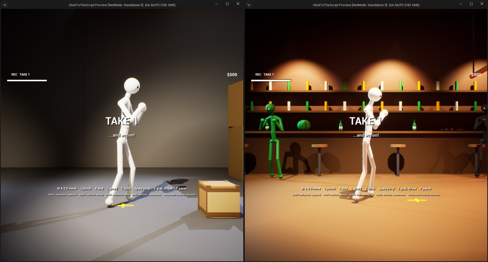

- **Went wrong:** the watermelon's stripes failed on the first run because a call returns its results in a different order than the agent assumed; the script fell back to a plain one, as it was written to, and the second run striped it.
- **Not verified:** the cone, the golden three and the three bought weapons have not been looked at in the game. How a weapon sits in the hands and moves in a swing is unseen. Not packaged yet.

### 04:23–04:29 · A shop for the banked money

- **Developer said (before going to bed):** "consider small in game shop to spend the money where u can buy customization for character or tools one time use to fight with like basebat or iron bar or hammer".
- **Agent did:** the title menu has a Shop row. The prop shop sells three weapons, a wooden bat ($150), an iron bar ($300) and a sledgehammer ($500), and three looks, a halo ($250), a crown ($400) and royal purple paint ($300). A weapon is for the next scene the player shoots: it lies at their feet at the start of every take of that scene, the scene card says so, and with that it is used up. A look stays bought, and the wardrobe passes over the ones not bought. One weapon waits at a time. What is owned is saved with the progress.
- **How the weapon gets on the set:** every scene keeps a hidden place for it from the start, the way the legendary drop is kept, so the take recorder has it from the first frame and the film shows it.
- **Result:** `Tools/check.ps1` passes with 8 tests; the new one checks that the exact price buys, a dollar short does not, and nothing is sold twice. By key presses in the editor: bought the bat, both hats and the paint; the shop answered "Sold." and then "That is yours already."; the wardrobe showed the halo and the crown; the scene card said "Your wooden bat is at your feet. Pick it up with E."; the fighter picked it up, held it like a batter and swung it.

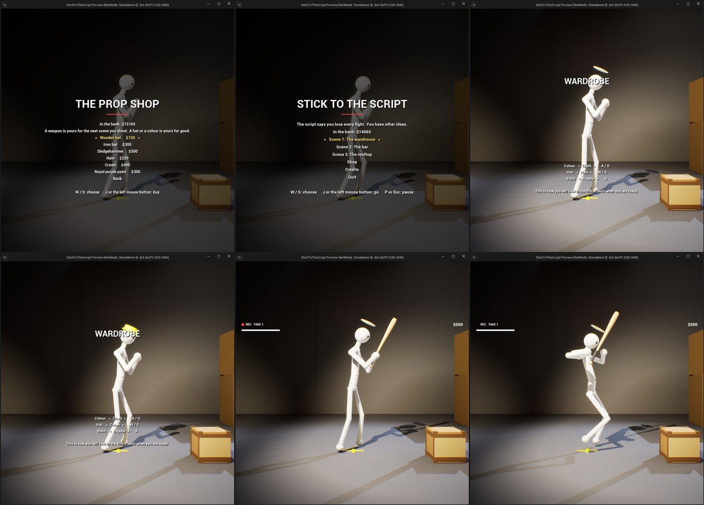

- **Went wrong:** the agent's first key-press script lost count of where the cursor was and bought more than it meant to. The second, shorter one did the scene.
- **Not verified:** "Not enough in the bank", because the editor's bank holds the test fighter's thousands. The bat landing on an opponent and breaking after eight blows. The iron bar and the sledgehammer in the hands. Whether the prices are right against what a scene pays.
- **Left behind:** the editor's saved progress now owns both hats and the paint, bought by the agent's test.

### 04:31–04:49 · The long run, pictures for the store, and where the night ended

- **Agent did:** ran the packaged game on self-play for 16 minutes at 1920 by 1080 and read its log; captured the game's own window every 20 seconds; put seven of those captures in `Docs/store` for the store page; cleared the progress the test runs had saved into the packaged game, so the developer starts with the scenes locked and an empty bank.
- **Result, the long run:** 15 takes, 10 wraps, 9 films and 3 results cards, which is three complete playthroughs from the title to the end and back to the menu. No errors and no fight that stopped moving. Median frame rate 108 in the warehouse, 117 in the bar, 112 on the rooftop, never under 105. Blows landed by the test fighter: 332 punches, 133 kicks, 59 sweeps, 53 chops, 53 uppercuts, 40 roundhouses, 38 thrown props and 21 kicks off a bar, from 13 grabs.
- **Found, not fixed:** 32 warnings of a figure "floating in the film". They are false alarms: the film's self-check does not know when a figure is off the floor on purpose, hanging from a bar or thrown up by an uppercut. They are lines in a log and change nothing on screen. In play, where the check knows about a jump, there were none.

**The night in one list, for the developer in the morning.** Everything below is on `main` and in the packaged build.

1. The package carries the Visual C++ runtime, so it starts on a PC without it. The text fits a window of any shape.
2. Four new moves with no new keys: uppercut and sweep from a duck, chop and roundhouse from a guard. The kick lifts its knee first.
3. Bars to hang from and kick off, in every scene.
4. Every prop is a real mesh, generated by a script. Three new weapons.
5. A shop on the title menu: weapons for a scene, hats and a colour for good.
6. Earlier in the night: the test fighter no longer stalls in front of a cornered gunman; retakes tire the opponents; a broken arm does not punch.

**What nobody has checked, in the order the agent would check it:**

1. **How any of it feels by hand.** Holding C or L and pressing a key for a move, and catching a bar by jumping under it, have only been done by the test fighter.
2. **Every sound.** The whoosh, the shout, the clang and all the older ones are made by code and have not been heard.
3. **Difficulty.** The new moves are strong: an uppercut does twice a punch's damage and leaves the victim helpless for a second. The game is easier than it was this evening, by how much is unknown.
4. **The prices** in the shop against what a scene pays, the iron bar and the sledgehammer in the hands, and "not enough in the bank".
5. **The cone and the golden three** as meshes, which were seen only in passing.

### 11:24–11:55 · "The game feel poor": a surface for every wall and floor, and a warehouse with a building round it

- **Developer said (after playing the night's build):** "ok looks good but in 2026 , and AI and claude , the game feel poor , what can we do?" Asked whether to start a pass on it now: "yes".
- **Agent said first, and was wrong:** it answered from memory that the game had no particles, no rag-doll knockouts and no film grain, and proposed to add them. The code has all three: blood, sparks off a guard, frozen frames, a rag doll on every knockout, grain and a vignette. The agent found that when it read the code before changing it, told the developer, and looked at the game's own screenshots instead of its memory. What they show: every wall, floor and figure is one flat colour, and the warehouse, the first scene anyone plays, is the barest of the three.
- **Agent did:**
  - `Tools/build_textures.mjs` paints six surfaces with nothing but arithmetic: concrete, brick, planks, wallpaper, roofing felt and corrugated metal. Each is a colour picture with its roughness in the alpha and a normal map, 1024 pixels square. Each one tiles, and the script refuses to write one whose edges do not meet.
  - `Tools/build_materials.py` brings them into the project and makes four materials. `M_Surface` lays a texture on a block by its place in the world, so a cube stretched into a wall does not stretch its bricks. `M_Figure` makes the stick figures smooth with a light edge. `M_Light` and `M_Sign` give light of their own, for windows, bulbs, neon and lettering.
  - The three stage scripts use them. The warehouse got what it lacked: brick walls, a concrete floor worn shiny in patches, steel columns under a beam, five high windows, three shipping containers, crates with frames, oil drums, hanging lamps and a painted walkway. The bar got striped wallpaper, a board floor, two neon tubes and its name in neon. The rooftop got roofing felt, a corrugated tank and air units, lit windows in the towers, a beacon and helipad lights.
- **Result:** `Tools/check.ps1` passes with 8 tests. All three scenes seen in the editor on self-play. Before on the left, after on the right:

- **Went wrong:**
  - A lacquer coat for the figures. Its two pins are closed to scripts in this engine version. Dropped; the figures are smooth without it.
  - Building a material a second time crashed the editor (`Assertion failed: !IsRooted()`, when the script cleared the old one). The stage scripts ran after the crash, against materials that were not there. Now a material that exists is left alone, and to change one its file is deleted first.
  - The neon sign was first a solid pink rectangle: the picture of the letters has one channel, and the script had asked for its alpha.
  - The first windows were blown out white. A glowing surface has to be judged against the set's fixed exposure, where a strength of about 30 is white.
  - The play window in the editor had been saved nearly square, so the first test pictures were cropped at the sides. Set back to 1280 by 720.
- **Not verified:** the frame rate with the new lamps (the warehouse has nine more, four of them without shadows). The packaged game. Whether the developer finds it less poor.

### 11:55–12:02 · A lens for the film, and the crew learns the new moves

- **Agent did, the film:** the two cameras that the film carries to each strike now have a lens: sharp where the blow lands, soft behind it and in front of it. An ordinary lens three metres from a figure blurs almost nothing, so the film's lens has a sensor three times as wide and is opened to f/2, which is what makes a miniature look like one. The fight itself is still filmed sharp all the way through. The plan listed a letterbox and camera shake as missing; both were already there.
- **Agent did, the fight:** each kind of opponent now has one of the bigger moves as its own, so the kinds can be told apart and the fight is not only the player's show. A thug chops, a rusher sweeps, a kicker throws the spinning roundhouse, the heavy has an uppercut. They show a bigger move for a third longer before it lands, so it can be read: step back, or duck the roundhouse. And the player is held helpless by one for half as long as an opponent is.
- **Result:** `Tools/check.ps1` passes with 8 tests. One self-played take of the warehouse: the crew threw 5 kicks, 3 punches, 3 roundhouses and an uppercut, and the test fighter did not go down. Four of the twelve frames taken of its film:

- **Not verified:** whether the fight is now too hard for a person. The test fighter wins without ever ducking a roundhouse on purpose, which says little about that. How the blur looks in motion.

### 12:02–12:12 · Packaged, measured, and new pictures for the store

- **Agent did:** packaged the game (647 MB, 9 more than last night) and ran it on self-play for six minutes at 1920 by 1080, taking a picture of its own window every 15 seconds. Before the run it kept a copy of the progress the developer had saved by playing this morning (two scenes wrapped, $2,119 in the bank, one look bought), and put it back afterwards: a self-played run earns money and would have left it in the developer's bank.
- **Result:** 5 takes, 4 wraps, 4 films, one results card; the test fighter never went down, with the crew now throwing roundhouses and uppercuts at it. Median frame rate 106 in the warehouse (108 before the new lamps), 117 in the bar, 111 on the rooftop, never under 103. The eleven warnings in the log are the known false alarm about a figure off the floor on purpose.
- **The store pictures are new.** The seven in `Docs/store` showed the old sets, so they are replaced by seven from this run. The strip along the top, where a tool on the developer's PC draws a frame counter into every game, is cut off, which answers one open point on the store page's list.

- **Not verified:** any of it by hand. A second PC. And the two things that this pass could not touch, because they need files or an account that only the developer can bring: real fight animation, and real recorded sound or a voice for the director.

### 12:14–13:22 · The director gets a voice, the blows get recordings, and every scene its own lines

- **Developer said:** pasted the list of the jam's partner perks and asked "do we need any of it now?". The agent named three worth claiming: fal for sound, because it is one API the agent can drive by itself; WeLoveIndies for music made by people; PBRgen for textures. It took the third back an hour later, when the textures were being painted by the project's own script. Asked whether to claim them: "Yes, I'll claim them".
- **Agent did, before any credit was spent:** read fal's own pages for what it offers and at what price. ElevenLabs sound effects at $0.002 a second, speech at $0.10 for a thousand characters, music at $0.60 a minute. It told the developer the first batch would cost about $1.30.
- **Agent did, the game:** a sound is still made in code unless there is a recording of it in `Content/Audio`; then the recording plays. One sound can have several takes and one is picked each time, so a row of punches is not one sample. The director now calls "Action!", "Cut!" and "That's a wrap", which he never did. Recorded music takes the place of the band made in code.
- **Agent did, the sounds:** `Tools/build_sounds.mjs` holds the whole list in words. Those words are the source, as with every other generated thing in this project. It asks fal for what is missing and cleans up what comes back: cut to where the sound starts, faded where it ends, brought to one loudness. `Tools/build_audio.py` brings the files into the project.
- **Developer said (while that ran):** "keep in mind different text and voice over at different scenes not always the same".
- **Agent did:** the director had six lines, the same six in every scene, and every scene began again at the first. Now each scene's own file has eight, about what that scene's script says should be happening. In the bar: "You get the bottle over the head! YOU do!" On the roof: "Watch the helicopter go! Sadly! Just watch it!" The game shows the words from that file and the sound script asks for the same words spoken, so they cannot drift apart. Each scene also has fight music of its own.
- **Result:** 65 recordings: 26 blows, whooshes and shouts, 11 calls, 24 scene lines and 4 music tracks. About $2.70 of the developer's $30 of free credit. `Tools/check.ps1` passes with 8 tests; the scene test now also asks every scene for lines of its own. The package is 656 MB.
- **How sound is checked by an agent that cannot hear:**
  - Every spoken line was given to a speech-to-text model (Whisper, also on fal) and its words compared with the script. All 35 match; it wrote "rap" for "wrap" once.
  - A stage direction in square brackets is meant to be acted. The timing fal returns for each character shows whether it was: acted, "[shouting]" passes in a fifth of a second.
  - The game's log names every recording it finds and every one it plays. The packaged game found all 65 and played 445 in four minutes of self-play.
- **Went wrong:**
  - fal's filter refused "one heavy kick landing on a torso". The heavy blow is now asked for as a sandbag hit with a bat.
  - The agent's own clean-up cut several soft clips down to nothing: it judged quiet against full scale instead of against the clip's own loudest moment.
  - Four clips came back silent. Three came at a second asking. One punch never did, so a punch has three takes and not four.
  - The key for fal reached the agent through the chat, which it had asked the developer not to do. It was kept in a temporary file outside the repository, used for these calls and deleted, and the developer was asked to delete the key at fal.
  - The credits card said every sound is made by code. It now names ElevenLabs and fal.
- **Not verified:** how any of it sounds. Nobody has heard it: whether the voice is a director, whether the blows fit the picture, how loud the music is against them. And the frame rate: the two runs after this change read 91 and then 42 frames a second in the warehouse against 106 this morning, but another game was running on the PC during both, so they measure nothing. To be measured again on an idle PC.

### 13:25–13:43 · Ship items: a team name, a cover, the zip, and the dev log made public

- **Developer said:** "Ship items". The agent asked three things it could not decide. The answers: the team is called "Page Twelve"; the dev log goes public as a new repository holding the log and the sources; the developer records the gameplay video and the agent cuts it.
- **Agent did:**
  - A cover for the store page, 630 by 500, from a screenshot of the packaged game.
  - The release zip: `PageTwelve_StickToTheScript.zip`, 379 MB, 98 files, one folder, no saved progress inside.
  - `Tools/publish_devlog.ps1` and a front page for the public copy. The copy is what is committed here, without the binary assets and without the history, committed under the developer's GitHub handle with GitHub's no-reply address. The private repository is not simply made public because its history carries a real name and an address on every one of its commits.
  - Before publishing: every text file searched for names, addresses, paths with a user's name in them and keys (none found), and all 50 pictures of this log looked at on three contact sheets (every one shows only the game's own window). The script makes the same search each time it runs and publishes nothing if it finds something.
  - The board: 32 tasks set to what they are. Eight are marked dropped, each with its reason: the blooper reel, the body-cam look, the director's notes, readable tells, the interface restyle and the three integration checkpoints.
- **Why the agent does not record the video:** this PC has no device that records what it plays, only a microphone, so a recording by the agent would be silent unless the game were taught to write its own sound to a file. And a person playing looks better than the game playing itself.
- **Result:** the dev log is public at https://github.com/ahmadkhalaf1/stick-to-the-script-devlog. The store page's checklist has its team name, cover and dev log link.
- **Not verified:** the zip on a second PC. The store page itself, which does not exist yet: the developer makes it. The video.

### 13:50–14:45 · The store page exists, as a draft

- **Developer said:** asked whether the agent was submitting the game and why it needed itch.io at all. The agent answered: nothing was submitted; the jam runs on itch.io, and the only way in is a game page there with the zip on it, which is then submitted to the jam. Then: "ok do what u have to do at ym browser".
- **Agent did:** in the developer's browser, created the game's page on itch.io as a draft and filled it in from `Docs/StorePage.md`: title, short description, the full description with the controls as a table, genre (fighting), five tags, no payments. It answered the site's question about generative AI with yes for graphics, sounds, text and code, and wrote two sentences on how it was used, with the link to this log.
- **What the agent left to the developer, and why:**
  - A check that the visitor is a person, and the sign-in. The agent does not pass the first and does not type passwords.
  - The cover, the screenshots and the zip. The page opens a file chooser for each, which the agent cannot see, and the agent's own way of uploading takes 10 MB while the zip is 379.
  - Making the page public and submitting it to the jam. Both wait for the developer's word.
- **Went wrong:** itch.io was down for about a quarter of an hour in the middle of this (error 522 on its home page and on the jam's page, checked from outside the browser as well). Which is the argument for uploading a day early.
- **Left out on purpose:** the gamepad column of the controls. No gamepad has been tried, and the page should not promise what nobody has checked.
- **Result:** the draft is at https://the-fighter-ps.itch.io/stick-to-the-script. Only the developer can open it.
- **Not verified:** how the page looks with its pictures, since it has none yet.

### 14:45–14:52 · The draft page gets its cover, its screenshots and the zip

- **Developer said:** "i want u to handle it all". And, while the files were going up: "i am still confused why u upload screen shots ad filse while the game is no yet ready?"
- **Agent answered:** nothing is public and nothing is submitted; the page is a draft only the developer can open, and what is on it is today's build as a safety copy. itch.io had been down for a quarter of an hour that same afternoon. If it is down or slow in the last hours before the deadline, an entry whose page already holds a working build is safe. Swapping the zip and the pictures for the final ones takes two minutes.
- **Agent did:** the three uploads it had said it could not do. The page opens a Windows file chooser for each, and the browser tool cannot see that window. A script can: `Tools/choose_file.ps1` finds the chooser that belongs to Chrome, writes the file's path into its name box and presses Open, so the browser itself reads the file and the 10 MB limit of the agent's own upload does not apply. Cover, seven screenshots, and the 379 MB zip, which took about a minute and a half. The zip is marked as the Windows download and the draft is saved.
- **Went wrong:** the script's first two tries found the chooser but not its controls. It was asking for a text box and a button by their kind, and in this chooser both report themselves as plain panes. They are now found by their window class and driven with the two window messages every such control answers.
- **Not verified:** the download, by fetching the zip back from the page and starting it. The page is a draft, so only the developer can.

### 14:52–15:27 · The gameplay video, recorded by the game itself

- **Developer said:** "Yes, record it". The developer had first chosen to record the video by hand, then asked the agent to "handle it all". Asked to close the other program that was using the PC, and to leave the PC alone for the recording: "Closed, record now".
- **The problem:** this PC has no device that records what it plays, only a microphone. A screen recording made by the agent would have been silent.
- **Agent did:**
  - The game can now write its own sound to a file: started with `-RecordSound=300` it records everything it plays for that many seconds.
  - `Tools/record_run.ps1` starts the packaged game on self-play, keeps its window on top, and records the window's picture with ffmpeg while the game records its sound. The player's saved progress is put back afterwards. It refuses to start when the processor is already busy.
  - `Tools/cut_video.mjs` reads the game's log to know when everything happened and picks the moments itself: the title, the wardrobe, the best blows of each fight (a kick off the bar counts for more than a punch, a knockout adds to whatever landed it), the wrap, the choice of cut, part of each film, and the ending.
- **Putting picture and sound in step, by measurement:**
  - The picture: the film's black bars appear the moment the log says the film starts. The first film is 21.70 seconds in the log and 21.67 in the picture.
  - The sound: every take starts with a clap out of silence, and the log says when the clap was asked for. The sound file turned out to run ahead of the log: by 404 milliseconds in the first scene, then 588, 683 and 761. It loses time whenever a level loads. Within a scene it holds: the film's first note, forty seconds after the clap, gives the same figure to within 40.
- **Went wrong:** the first cut used the sound file as if it kept the log's time, so every blow in it sounded up to three quarters of a second before it landed. The frames looked right and the agent cannot hear, so nothing showed it. It was found only because the agent measured where the clap was instead of trusting where it should be. A check the agent then wrote, "the loudest moment near a blow should be the blow", did not work, because a whoosh and a shout come before a blow and are as loud; it was taken out again.
- **Result:** `Saved/Release/StickToTheScript_gameplay.mp4`: 56 seconds, 1920 by 1080 at 60 frames a second, 54 MB, eighteen pieces. It is not in the repository.
- **And an answer to an open question:** in this run the game held a median of 98 frames a second in the warehouse, 107 in the bar and 103 on the rooftop while its window was being recorded. So the recorded sound costs nothing, and the 42 measured two hours earlier was the other program.
- **Not verified:** nobody has watched it with its sound on. The upload and the link.

### 15:27–15:44 · The video gets its link, and a look at the music library

- **Developer said:** to "Shall I upload the video to YouTube from your browser as unlisted?": "Yes, unlisted". Later: "I'll upload it", and then the link.
- **What happened:** the agent could not do the upload. YouTube's upload page opened and the developer was signed in, but on that site another extension in the developer's browser makes the agent's browser tool refuse every click, key press and screenshot; reading the page still works. The way round that had worked for the file chooser, pressing controls through Windows, only reaches the tab that is in front, and this one was not. So the agent said so, prepared the file under a readable name with the text to paste, and the developer uploaded it in two minutes.
- **Agent did:** checked that the link opens for someone who is not signed in, put it in the draft store page's video field, and saved the draft.
- **Developer said:** "and btw i did create account at weloveindies ... u can view it in browsre and see how to use".
- **Agent did:** looked. Tracks and sounds are collected into a project, licensed and downloaded as one zip; the licence for jam entries is free, bound to the one project, and a commercial release needs a paid one. The agent's advice: the game has its music, and whether tracks made by people would be better is a question for ears, which the agent has not got; listen to the video first. The developer: "Keep the music". Nothing was taken from there.
- **Result:** the gameplay video is at https://www.youtube.com/watch?v=zvQRRTC56iA.
- **Not verified:** whether the video is set to unlisted or public; the agent can see only that it opens.

### 15:59–16:06 · The sticks become stunt dummies

- **Developer said:** the game is not ready to submit, and then: "do u recommend using better character than the stick figure? maybe sth more modern or nicer in 2026".
- **Agent advised against a different character, and said why:** every move beyond three animations, and the whole film, exists only as the positions of the stick's sixteen joints. A normal skinned character does not follow those joints, so it would lose the uppercut, the sweep, the roundhouse, the bar and the broken arm, with two days left. What it proposed instead: keep the joints and give them a body, as a stunt dummy, which is also what the story says these figures are. The developer: "ok".
- **Agent did:** in the one function that draws a figure from its joints:
  - a chest, a waist and hips round the spine, and a boot on each foot that stands square to its shin, so it follows the leg through a kick;
  - limbs of different thickness: a thigh thicker than a calf, an upper arm than a forearm;
  - joints, fists and boots in black rubber, or in steel on a figure that is itself near black;
  - a crash dummy's yellow mark with a black centre, on the chest and on the outside of each shoulder.
- **Result:** `Tools/check.ps1` passes with 8 tests. Nothing underneath changed, so the moves, the film, the skeleton flash and the wardrobe's builds work as before. The bar in play above, the warehouse film below:

- **Went wrong:** the first version had its marks on both sides of the head. The fight is watched from the side, and there a yellow disc with a black centre on the temple reads as one huge eye. They moved to the shoulders.
- **Not verified:** the rooftop; a broken arm, the hats and the wardrobe's other builds with the new body; whether the chest is too round in a close shot, which is a matter of taste for the developer. The store's screenshots and the gameplay video still show the sticks.

### 16:06–16:32 · The developer keeps the stunt dummies

- **Developer said:** "show me", and on seeing the sticks and the dummies side by side: "i like it keep i".
- **Agent did:** looked at what it had not yet seen with the new body: the rooftop in play, and the wardrobe with a crown on. Both are right.
- **Still to do because of it:** the gameplay video, the store's screenshots and the zip on the draft page show the sticks. They are made again once, when the game is final, not after each change.

### 16:32–16:48 · Real fight animations: where they come from

- **Developer said:** asked what should come next to make the game ready: "Real fight animations".
- **Agent did:**
  - Searched the engine's own templates for fight animations. There are none beyond the three punches and the charged attack the game already uses; the rest are deaths and hit reactions made for a rifle. So they have to come from outside.
  - Proposed Mixamo, Adobe's free library of motion-captured animation, and said what it would take, including the developer's own sign-in. The developer signed in, and gave the word for the one click that lets Adobe see the account's name and address; by then the page had already moved on by itself.
  - In the developer's browser, downloaded eleven clips: Fighting Idle, Jab Cross, Hook Punch, Uppercut, Mma Kick, Roundhouse Kick, Leg Sweep, Flying Kick, Hanging Idle, Head Hit and Stomach Hit. 20 MB in all, kept in `Saved/Incoming/Mixamo`, outside the repository.
- **Went wrong:** four of the first downloads were the wrong clip, twice over. The agent clicked where the first result of a search usually is; a search with one or two results centres them, so the click hit nothing and the download button gave the clip chosen before. The file names showed it, and those four were fetched again by looking first. A "body block" turned out to be a goalkeeper's and was thrown away; the guard keeps its computed pose.
- **Result:** the clips are on the PC. Nothing in the game uses them yet. What remains is in the task note: fit Mixamo's skeleton to the mannequin's, which is the risky part, and give each move its clip.
- **Not verified:** that these clips convert at all.

### 16:48–16:52 · The eleven clips fit the mannequin's skeleton

- **Developer said:** offered the choice of starting the risky part tomorrow with a fresh week of usage or now: "Start now".
- **Agent did:** `Tools/build_animations.py`, run without the editor's window. It imports the eleven FBX files (the first whole, to get Mixamo's skeleton; the rest as animation on it), has the engine make a rig for each of the two skeletons, maps one onto the other, and converts every clip to the mannequin.
- **Result:** eleven of eleven converted, in `Content/Characters/Fight`, 16 MB. The engine recognised both skeletons by itself: spine, neck, head, arms, legs and fingers were matched without a line of mapping. The feared step took three runs and twenty minutes.
- **Went wrong:**
  - Run one: the last call had a parameter in the wrong place for this engine version, after everything before it had worked.
  - Run two: the script deleted one old rig before making it again. The retargeter still pointed at it, the delete left a stub, and the new rig could not be made. It now clears everything an earlier run left in one go, before it starts.
- **Not verified:** how any clip looks on a figure. A conversion can succeed and still put an arm through a chest. Nothing in the game uses the clips yet.

### 16:55–17:15 · The clips were empty; converted again, and the kicks are real

- **Developer said:** nothing new; this carries on from "Real fight animations" and "Start now".
- **Agent did:**
  - Before wiring anything, measured the eleven converted clips without the editor's window: where the hips, hands and feet are, thirty times a second.
  - Found them empty, fixed the script, converted again, and measured again.
  - Wired eight clips into the fighter: the kick, the uppercut, the sweep, the roundhouse, a hook punch for the chop, a fighting stance in place of the hands-up pose, and two ways of taking a blow, to the head and to the body. A move keeps its own timing and rules; the clip is fitted to them, and the moment of contact is found in each clip the way it always was for the punches.
  - Played the warehouse on self-play three times in the editor, once through to its film, then packaged.
- **Result:** the kick is a kick: a standing leg, the other one out flat, a foot on a chest. The hook lands and bends its man backwards. The opponents stand like boxers instead of holding two fists up. In the log, five kicks stopped 12 to 34 cm from the body they hit. The film shows the same motion with nothing changed in it. The packaged Windows build has the clips too: it played itself for a minute and a half, wrapped the warehouse and showed its film at 110 frames a second, with nothing missing in its log.
- **Went wrong:**
  - **The entry before this one is wrong.** It says eleven of eleven clips converted. They were converted into nothing: all eleven held the mannequin's standing pose from the first frame to the last. The script reported success and the files were 16 MB. That entry did say "not verified: how any clip looks", and the first look found it: every clip gave the same numbers, to the centimetre.
  - The cause: a retargeter made from a script starts with no steps in it, so it copies nothing. Made in the editor's window, it gets them without asking. One line adds them. The script now measures how far a hand or a foot travels in every clip it makes and fails if nothing moves (the idle moves 15 cm, the kick 191).
  - The plan written at 16:55 said to hold the figure in place by taking the hips' drift out. The measurement said not to: every clip returns to where it began, and the drift is the step into the strike. The plan note says what was done instead.
- **Changed without being asked:** the moves reach further than the poses did (the kick 133 cm for about 88), because the picture has to match the rule. That is a change to how the fight plays.
- **Not verified:** the sweep was caught only in its crouch and the uppercut behind another fighter, so neither has really been seen. A blow taken to the body was not caught in a picture. Nobody has played it by hand, so whether the longer reach makes the fight easier or harder is not known. Taking a clip away to see the old pose come back was not tried.

### 17:24–17:42 · The usual keys

- **Developer said:** after starting the build to see the new animations: "keybinds are hard and not usual". And while the agent was on it: "maybe right mouse should be used to block hits".
- **Agent did:**
  - Read the bindings before changing any. The usual keys were already there: left click punched, Shift guarded, Ctrl ducked, Esc paused. The game only ever named the other set, J K L C P, and so had the agent, a few minutes earlier, when telling the developer how to try the moves. A chop was "hold L and press K": two keys under one hand.
  - Took the developer's suggestion: the right mouse button guards. It had been the kick, so the kick went to F, which had been a spare key for grabbing. Every old key still works.
  - Rewrote what the game says: the line shown as a take is called, the pause card, the wardrobe, the hints under the menus, and the store page's table. The special moves are now named by what you hold, "guard and punch: chop", not by a key.
  - Made that line stay for the first 14 seconds of a scene's first take. It used to vanish with "and action!", after about two.
- **Result:** in a take in the editor, three clicks threw punches and F threw a kick, by the log. The line and the pause card fit and read. The packaged Windows build was made again from this and played itself for half a minute with no errors; the line of keys was not looked at there, only in the editor.
- **Went wrong:**
  - The first test reported that clicks and F did nothing. They had: the clicks had confirmed the wardrobe and the scene's card, and the test ended before the fight began. The test's own pictures showed it. Run again inside a take.
  - That picture also showed the wardrobe still saying "K" for the build. Fixed.
- **Not verified:** holding the right mouse button to guard. The agent's tools can click a left button and press keys, not hold a right button. It is read by the same code as Shift. Nobody has played with the new keys by hand.

### 17:45 · The developer on the keys: "keys good"

- **Developer said:** asked "where to test"; the agent started the packaged game on the developer's PC and said where it is. After playing: "keys good".
- **Result:** the keys stay as they are. The developer has now also played the motion-captured moves, in the same build, and has said nothing about them or their longer reach yet.

### 17:50 · The developer on the longer reach: "No, it's fine"

- **Developer said:** "i dont understand what u mean with their longer reach". The agent had used the word three times without saying what it meant.
- **Agent did:** explained it in plain terms: a kick used to hit someone up to about a metre away and now hits at about a metre and a half, because the motion-captured kick steps in and stretches further than the pose did. Said what to try: win the warehouse by kicking from as far as it connects, and see whether the opponents still get to you.
- **Result:** asked whether the scene can be won that way without being touched: "No, it's fine". The reach stays.

### 17:53–18:09 · The hang becomes a swing

- **Developer said:** "swing at the bar should not stay solid when he catch it bar , he should swing , add some realistic physics to it".
- **Agent did:** the hang was a fixed pose that rocked seven degrees on a timer. It is now a pendulum: the body keeps the speed it caught the bar with, gravity brings it back, it slows a little every second, the walk keys push it, and the legs follow a moment late. Letting go throws the fighter off the way the swing was going. A fighter may hang for 3.6 seconds instead of 2.4, since there is now something to do up there.
- **Result:** fourteen pictures of one hang, on self-play in the editor: out to about half way to level, back to straight down, out again, then the kick off the bar, which landed. The Windows build was packaged again from this at 18:08. It has not been run since.
- **Went wrong:** the first version let a held direction key drive the swing nearly level and keep it there, which no body can do. The push was eased from 7 to 5.
- **Not verified:** letting go with the jump key in mid-swing; pushing the swing by hand, in time with it. Both need a person at the keys.

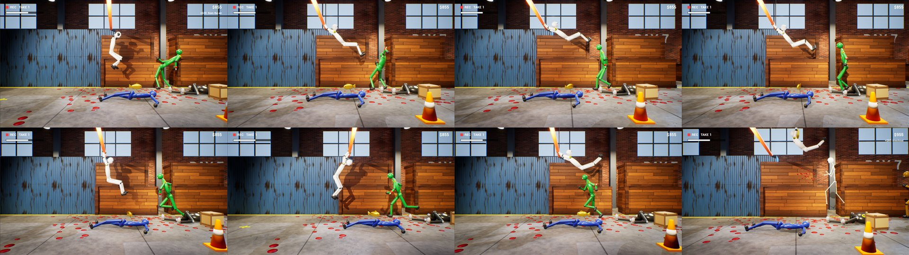

### 18:27 · The developer on the swing: "Swing is good"

- **Developer said:** asked to try the bar in the warehouse in the build packaged at 18:08: "Swing is good".
- **Result:** the swing stays as it is. That build had not been run by the agent; the developer's play is its first run.

### 18:41–18:46 · The punch becomes a jab and a cross

- **Developer said:** asked "what do u think we need to improve more?". The agent named three things: nobody has listened to the sound, the punch is the one move not on motion capture, and the film gives the player a choice of three cuts but no edit of their own. And two that are not improvements: the bar and the rooftop have not been played by hand with the new moves, and the store page shows the old game. The developer: "Yes, punches".
- **Agent did:** made the jab-and-cross clip, converted and unused since this afternoon, the punch of any fighter with two sound arms and empty hands. Renamed the guard-and-punch move from "chop" to "hook" wherever it is said in words, since a hook is what it has been since the clips went in.
- **Result:** one punch photographed in slow motion: the stance, a step in, the right arm out straight, and back. The punch now starts from the stance the fighter is standing in, which the engine's punches did not. The Windows build was packaged again from this at 18:45. It has not been run since.
- **Went wrong:** the first test photographed the punch the first time it was thrown, and that time it was thrown from a jump. A second test threw one on the ground.
- **Not verified:** a punch with one arm broken or a weapon in the hands, which keep the old animations by design. How the jab reads at an opponent's slower speed, where the whole clip is shown: the pictures are of the player's fast punch. Nobody has played it by hand.

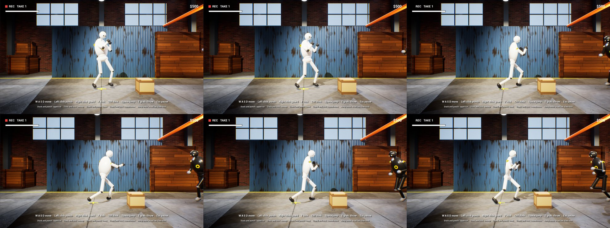

### 19:11–19:26 · A blow that lands gets a burst of light, a longer freeze and more sound

- **Developer said:** on the new punch: "Needs work". Asked what, with four choices and room for words: "make it feel like a real hit and make sound effects and visual effect maybe if needed", and the choice "Does not look like a hit".
- **Agent did:** read what a landed blow already did before adding to it: a short freeze, blood, a recorded sound, a jolt of the camera, a skeleton flash. Nothing happened at the point of the blow. Added a burst of light there with rays shooting out, sparks, nearly doubled the freeze of a light blow, played the blow's recording louder with the code-made thump under it, and strengthened the camera's jolt.
- **Result:** in pictures of a fight on self-play, the burst shows round the struck fighter as rays, at the moment the figure flashes to a skeleton. The Windows build was packaged again from this at 19:25. It has not been run since.
- **Went wrong:** the first burst was a plain sphere, and the picture showed what that is: a pale ball nearly a metre wide, sitting over two fighters like a beach ball. It was not even bright, because on these sets a strength of 30 is merely white. Rebuilt as a small core and eight thin rays, five times brighter.
- **Not verified:** the sound. The agent cannot hear it, and it now plays two sounds together for every blow, which may be better or may be mud. Whether a punch now feels like a hit is the developer's to say.

### 19:29 · The developer on the blows: "Feels like a hit"

- **Developer said:** asked to play the build packaged at 19:25 with the sound on and say whether a punch now feels like a hit: "Feels like a hit".
- **Result:** the burst, the longer freeze and the layered sound stay. The developer's play was that build's first run. Nothing was said about the sound on its own, so the mix as a whole (the director's voice, the music against the blows) is still unjudged.

### 01:31–02:15 · The fighters get a real body

- **Developer said:** "i still feel like we need to improve graphic and character alot to fit a game in 2026". Asked whether the work left could be finished from the normal reset of the usage limit, and shown a "Fable reset" button on the plan's own page, asked what it would do. The agent read out what the card said: free, no extra credit, refills this model's allowance and gives back its share of the week. The developer used it: "Reset done, go". Later, seeing the result come up: "which 3d character is that? is it the default from unreal?"
- **Agent did:**
  - Agreed the character was the largest gap, and said plainly that replacing it was the riskiest job left: every pose in the game is worked out on sixteen joints, and a skinned model would have to follow them bone by bone.
  - Brought in the model that came with the fight clips, Adobe's "X Bot", by a script. Wrote the part that puts its bones on the joints every frame: the trunk, arms and legs with their elbows and knees, feet that lie flat under a standing leg, fingers closed into fists.
  - Left the game itself alone. The joints are still the truth and the model only dresses them, so the film, the hang on the bar and the broken arms needed nothing. The old plain shapes stay as the skeleton flash and as the fallback.
  - Answered the developer: not Unreal's default, Mixamo's stock model, which some judges will know.
- **Result:** it stood in the fighting stance in the first picture after the first compile. All three scenes, the film with its close-ups, the wardrobe with a hat, and the packaged build show it. The picture says the rest.
- **Went wrong:**
  - Every fighter came out the same grey. The figures' material was made for plain shapes; on a skinned model the engine swaps an unmarked material for plain grey and says so once in the log. The model's script now marks it.
  - Packaging failed. Setting the model on the component the short way trips a check in the engine that play in the editor forgives and the cook does not. Found only because the build is packaged before a milestone is called done.
  - Six warnings of a fighter "floating" after a blow sent the agent looking for a bug in the day's changes for twenty minutes, through two rounds of extra logging. The log's own frame numbers had the answer: the editor was running at three to five frames a second, because another game was running on the PC, and at that rate a whole jump fits inside one frame. The watch now ignores frames that slow.
- **Not verified:** the frame rate, for the same reason: 89 a second in the packaged warehouse against 110 in the afternoon means nothing with another game running. A broken arm, the other hats and the stout and slight builds on the new body. Nobody but the agent has seen it move.

### 02:19–02:39 · Props that drop in, bounce and break; a question about guns

- **Developer said:** earlier, in a list of what still looked old: "throwing items also need improvbment in quality and graphic and spawning and holding and throwing techinqes". And in the middle of this work, a question: what if the fist fights became gun fights, with a shotgun, limbs shot off, weapons picked up from the ground, ricochets, and how much effort would that be.
- **Agent did:**
  - Read how a prop arrives, lands, is held and thrown before changing it. It was there when the take began, stuck where it touched the floor, vanished when it broke, and was thrown with the arms alone.
  - Gave it a drop into place as the take is called, a bounce and a settle, ten flying pieces where it breaks (in the film too), and a throw that leans the whole body.
  - Eased the warehouse's flat overhead light and thickened its haze. The sets already had haze, bloom, grain and a fixed exposure, so the "lighting pass" the agent had promised was mostly there, and it said so.
  - Answered the question about guns: replacing the fist fighting is three to five days of work and cannot be done well by Monday; adding a shotgun and a pistol on top of what exists is five to seven hours, because the gunman, the weapons picked up from the floor, the shop, the impact effects and the new body made of parts are already there. The decision is the developer's.
- **Result:** a crate tumbles onto the set at "action". A throw bends the thrower. A bottle broke into pieces in a take and broke again when the film replayed it.
- **Went wrong:** the film did not break the bottle at first. The agent had told it to look for a prop dropping exactly two thousand units straight down between two frames, and a prop in flight has moved sideways by the next frame. It now looks for a prop that has gone deeper than one held in reserve ever is.
- **Not verified:** how the pieces look; no picture caught them at a size that shows. The packaged build's frame rate: the check ran at nine frames a second with another game in front. How a bat sits in the new hands.

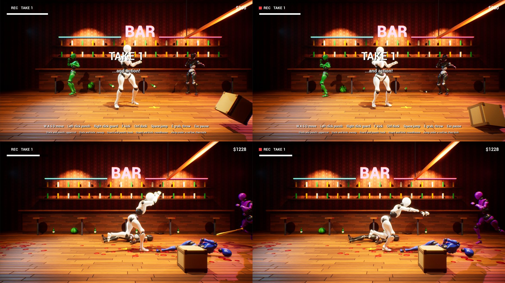

---

## Asset and tool register

Kept current for the submission form.

| Item | Source | Use |
|---|---|---|
| Unreal Engine 5.8.3 | Epic Games | Engine |
| Mannequin meshes, rigs and animations | Engine template content (Epic Games) | Skeleton and motion for the stick figures |
| Claude Code, model Claude Fable 5.2 | Anthropic | Research, code, editor automation, this log |
| Unreal MCP and toolset plugins | Engine (experimental, editor only) | Lets the agent operate the editor |
| ponytail, Karpathy guidelines, claude-code-setup | Claude Code plugins | Agent behaviour only; not in the game |
| Sounds made in code (hits, breaks, whoosh, clapper, sting) | Made by the team: synthesised at start-up | What plays wherever no recording exists. The sting on "Cut!" is always this |
| Recorded blows, whooshes, shouts, clapper and gunshot (26 takes) | ElevenLabs Sound Effects v3, through fal.ai. Asked for in words by `Tools/build_sounds.mjs`; the words are in that file | Played in place of the sounds made in code |
| The director's voice (35 takes: 24 scene lines, 11 calls) | ElevenLabs Eleven v3 text to speech, voice "Callum", through fal.ai. The lines are in `Content/Scripts/Scene*.json` and `Tools/build_sounds.mjs` | "Action!", "Cut!", "That's a wrap", and what he shouts during a fight |
| fal.ai | A partner of the jam. $30 of credit claimed by the developer, about $2.70 used | The API the recorded sound, voice and music were asked through, and its Whisper model to check the spoken lines |
| ffmpeg | Open source, on the developer's PC | Turns what fal sends into WAV files; not in the game |
| Music made in code (fight pulse and film track) | Made by the team: a drum machine, bass and lead synthesised while the game runs | What plays where no recorded track exists |
| Recorded music (a fight track for each scene and a film theme, a minute each) | ElevenLabs Music, through fal.ai. The prompts are in `Tools/build_sounds.mjs` | Played in place of the music made in code |
| Block, duck, kick, flinch, broken arm, blood | Made by the team: computed in code | No animation or effect assets beyond the engine mannequin |
| Things to throw and hold (crate, bottle, watermelon, traffic cone, frying pan, bats, hammers, iron bar, golden fish) | Made by the team: meshes generated by `Tools/build_props.py` with the engine's Geometry Script, which turns profiles like a lathe and joins boxes and rods. One material, also made by that script | Props and weapons |
| Geometry Script plugin | Engine (editor only, switched on from the command line for that one script) | Builds the prop meshes; not in the game |
| Stage levels and their materials | Made by the team: generated by `Tools/build_stage01.py`, `build_stage02.py` and `build_stage03.py` from engine cubes and cylinders | The sets |
| Surface textures (concrete, brick, planks, wallpaper, roofing felt, corrugated metal) | Made by the team: painted by `Tools/build_textures.mjs` from noise and arithmetic, brought in by `Tools/build_materials.py` | Walls, floors, crates, containers |
| Lettering on the sets | The engine's own font (Roboto) | The neon sign in the bar, the bay number in the warehouse |
| Scene scripts | Made by the team: text files in `Content/Scripts` | The fights |
| The fighters' body: the "X Bot" model, skin and skeleton | Mixamo (Adobe), free with an Adobe account, royalty-free inside a game. It came inside the FBX files of the clips below, downloaded on Fri Nov 13 | What every fighter is seen as, since the night of Nov 13 to 14 |
| Fight animations (eleven clips: a stance, punches, kicks, a sweep, an uppercut, hanging, two hit reactions) | Mixamo (Adobe), free with an Adobe account, royalty-free inside a game. Downloaded on Fri Nov 13; nine of them in the game since that evening | The punch, the kicks, the uppercut, the sweep, the hook, the stance and the blows taken |
