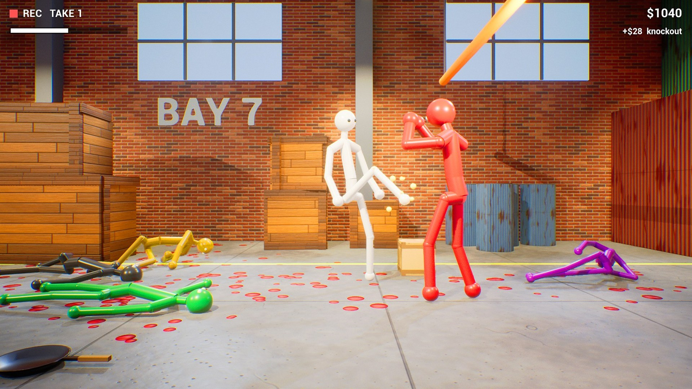

# Stick to the Script: dev log and sources

An entry to the [2026 Epic AI MegaJam](https://itch.io/jam/2026-epic-ai-megajam) (Unreal Engine 5.8, theme "Director's Cut"), made in four days, Nov 12 to 15, by one developer directing an AI coding agent, Claude Code.

You are a stunt performer hired for a scene, and the script says you lose. You ignore it, win the fight, and then cut the film yourself.

## Start with the dev log

**[DEVLOG.md](DEVLOG.md)** was written while the work happened, not afterwards. Every entry says what the developer asked for (in the developer's own words), what the agent did, what came of it, what went wrong, and what nobody had checked. The agent's mistakes are in it, including the ones it made about its own work.

## What is here

| | |
|---|---|
| [DEVLOG.md](DEVLOG.md) | The log, with its pictures in [Docs/devlog](Docs/devlog) |
| [CLAUDE.md](CLAUDE.md) | The rules the agent worked under |
| [Plan](Plan) | The plan: sprints, one note per task, and the contracts between parts of the code. The folder is an Obsidian vault |
| [Tools](Tools) | The scripts that generate the game's content and that check, package and release it |
| [Source](Source) | The game's C++ |
| [Content/Scripts](Content/Scripts) | The three scenes as text files: who fights where, and what the director shouts |
| [Docs/StorePage.md](Docs/StorePage.md) | The store page's text and the list of tools and assets for the jam's form |

## What is not here

- **The game's binary assets.** Levels, materials, textures, props and recordings are left out, and every one of them is made by a script that is here: `Tools/build_stage01.py` to `03`, `build_materials.py`, `build_textures.mjs`, `build_props.py`, `build_sounds.mjs` and `build_audio.py`. The one thing not made that way is the Unreal Engine mannequin, which is Epic's and comes with the engine.
- **The history.** This is a copy of the project's state, refreshed by `Tools/publish_devlog.ps1`. The dev log is the history.

## How it was made

The developer said what to build and judged the result. The agent researched, wrote the code, drove the Unreal editor, wrote and ran the scripts, tested the game by letting it play itself, and kept the log.

The stick figures are drawn in code on the mannequin's skeleton. The sets, their brick, boards and concrete, and every prop are generated by scripts. The director's voice, the blows and the music were generated with ElevenLabs models through fal.ai, from words that are in `Tools/build_sounds.mjs` and in the scene files.

The full list of tools and of everything not made by the team is the register at the end of the dev log.
